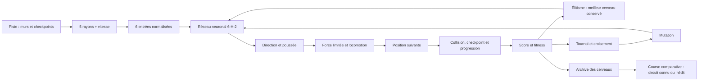
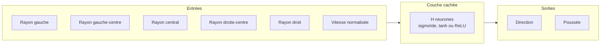

# Analyse du projet Neuro Racing

**Autrice :** HAJAR BELHACHMI<br>
**Formation :** Master IA2 — Université Côte d’Azur<br>
**Année universitaire :** 2026/2027<br>
**Nature du document :** analyse fonctionnelle et technique du projet<br>
**État décrit :** code de `Conduite Évolutive/` au 18 octobre 2026 (23 fichiers de tests, 246 tests)

## 1. Synthèse

Neuro Racing est une simulation web d’apprentissage par neuroévolution. Une population de voitures circule sur un circuit fermé. Chaque voiture observe les murs à l’aide de cinq rayons et mesure sa propre vitesse. Ces six valeurs sont transmises à un réseau neuronal dense, qui produit deux commandes : orientation et poussée. À la fin de chaque génération, les voitures sont évaluées ; le meilleur cerveau est reconduit tel quel (élitisme), puis les autres descendants naissent de parents choisis par tournoi, croisés avec une certaine probabilité, puis mutés.

Le projet met en œuvre une boucle complète reliant **perception**, **décision**, **locomotion**, **évaluation**, **sélection** et **sauvegarde**. Autour de cette boucle, il ajoute des outils d’expérimentation : une **graine aléatoire** pour rejouer une expérience, un **entraînement sur plusieurs circuits** et un test de **généralisation** lors des courses entre cerveaux archivés, un **chronomètre** et un classement au temps de tour, l’**export CSV** de la courbe d’apprentissage, la **persistance des réglages**, ainsi que des **sons synthétisés** et des **effets visuels** purement cosmétiques. Son intérêt principal est d’exposer ces étapes dans une interface qui permet de modifier l’expérience, de voir les capteurs, d’inspecter les poids et de comparer les cerveaux conservés.

## 2. Périmètre et objectifs de l’analyse

Cette analyse décrit le comportement présent dans les fichiers de l’application et les tests disponibles. Elle vise à :

- expliquer la structure des composants et leurs échanges ;
- suivre le chemin d’une observation jusqu’au déplacement d’une voiture ;
- présenter les principes et coefficients de la fitness ;
- examiner la sélection, le croisement, la mutation, l’entraînement multi-circuits et la persistance des réseaux ;
- expliquer ce qui relève de la reproductibilité (graine) et ce qui reste purement cosmétique (sons, effets, décor) ;
- distinguer les capacités effectivement testées des limites des tests automatisés ;
- dégager des pistes d’expérimentation et des améliorations possibles sans les présenter comme des fonctionnalités déjà présentes.

## 3. Vue d’ensemble du système

### 3.1 Schéma des principales étapes



Le schéma résume une génération. Le réseau agit à chaque pas de simulation ; la sélection, le croisement et la mutation interviennent lorsque la population active est épuisée. En mode multi-circuits, la génération se compose de plusieurs tours, un par circuit, et la sélection n’a lieu qu’après le dernier (section 8.3).

### 3.2 Chaîne de traitement d’une voiture

| Étape | Opération | Résultat |
|---|---|---|
| Perception | Les cinq rayons cherchent leur intersection la plus proche avec les murs ; la vitesse est mesurée. | Six entrées numériques normalisées. |
| Inférence | Le réseau calcule ses deux sorties à partir des entrées. | Une commande de rotation et une commande de poussée. |
| Steering | La commande est convertie en cap et vitesse désirée ; l’écart avec la vitesse actuelle donne une force limitée. | Une accélération bornée par la force maximale. |
| Locomotion | Le véhicule additionne la force, limite sa vitesse et déplace sa position. | Nouvel état physique. |
| Règles de course | Le contrôleur traite la progression, les checkpoints et les collisions ; la voiture met à jour ses compteurs de vie et de score. | Progression, arrivée (avec temps de tour) ou élimination. |
| Évaluation | La progression, le score, la vitesse et diverses pénalités sont combinés. | Fitness qui sert à comparer les individus. |
| Évolution | Le meilleur cerveau est reconduit ; les autres descendants viennent d’un tournoi, d’un croisement éventuel et d’une mutation. | Nouvelle population candidate. |

## 4. Architecture logicielle

Les scripts sont chargés en tant que scripts classiques dans [index.html](./index.html), après p5.js 1.9.0 et TensorFlow.js 4.20.0 (CDN jsDelivr). L’ordre de chargement rend disponibles les bibliothèques, les variables globales et les classes dont dépend ensuite le contrôleur : `globals`, `utils`, `Random`, `NeuralNetwork`, `BrainStorage`, `Settings`, `Sound`, `Effects`, `Ray`, `Track`, `Vehicle`, `Car`, `Genetic`, `MultiTrack`, `Generalization`, puis `main`.

| Fichier | Responsabilité principale | Type de données ou de résultat important |
|---|---|---|
| [globals.js](./js/globals.js) | Paramètres et état global : taille de population, rayons, pistes, modes, réglages physiques, graine, taux de croisement, élitisme, multi-circuits, état de course. | État de la simulation. |
| [utils.js](./js/utils.js) | Fonctions géométriques : distance point-segment, distance segment-segment (collision balayée), intersection segment-rectangle orienté. | Distances et tests de contact. |
| [Random.js](./js/Random.js) | Hasard reproductible (générateur mulberry32), lecture et validation de la graine, tirages uniformes, entiers et gaussiens. | Flux aléatoire unique de l’évolution. |
| [NeuralNetwork.js](./js/NeuralNetwork.js) | Création (initialisation seedée), prédiction, copie, mutation, croisement par neurone caché, conversion JSON et validation des réseaux. | Réseaux et poids. |
| [BrainStorage.js](./js/BrainStorage.js) | Persistance navigateur, import/export, validation de l’archive, limite de capacité, écriture vérifiée et sauvegarde d’une archive abîmée. | Enregistrements de cerveaux. |
| [Settings.js](./js/Settings.js) | Table des réglages persistés, validation des valeurs relues, lecture et écriture dans `localStorage`. | Réglages restaurés entre les sessions. |
| [Sound.js](./js/Sound.js) | Moteur audio synthétisé (Web Audio) : moteur de la voiture de tête, collisions, checkpoints, arrivées, fanfare, départ de course ; préférences de son. | Sons cosmétiques. |
| [Effects.js](./js/Effects.js) | Particules et flashs : étincelles, débris, fumée, ondes de choc, confettis, éclair de checkpoint. | Effets visuels cosmétiques. |
| [Ray.js](./js/Ray.js) | Construction d’un rayon, intersections avec un mur et rendu de sa mesure. | Point d’intersection et distance. |
| [Track.js](./js/Track.js) | Génération des circuits prédéfinis et personnalisés, bordures et checkpoints, fermeture et validation des tracés dessinés, rendu du décor mis en cache. | Géométrie de piste. |
| [Vehicle.js](./js/Vehicle.js) | Intégration de l’accélération, de la vitesse et de la position. | État cinématique du véhicule. |
| [Car.js](./js/Car.js) | Capteurs, inférence, direction, score, checkpoints, temps de tour, anti-stagnation, conditions de fin de course et dessin de la voiture. | Voiture et cerveau. |
| [Genetic.js](./js/Genetic.js) | Fitness, élitisme, sélection par tournoi, croisement, construction de la génération suivante et archivage automatique. | Classement et descendants. |
| [MultiTrack.js](./js/MultiTrack.js) | Entraînement sur plusieurs circuits : enchaînement des tours, agrégation des résultats, réapparition des mêmes cerveaux. | Score et fitness moyens d’une génération. |
| [Generalization.js](./js/Generalization.js) | Comparaison entre les circuits d’entraînement d’un cerveau archivé et le circuit de la course (« connu » ou « inédit »). | Bilan de généralisation. |
| [main.js](./js/main.js) | Initialisation, boucles d’entraînement et de course, collisions, interface, éditeur de piste, graphiques, export CSV, graine, raccordement des sons et effets. | Scène et événements utilisateur. |
| [style.css](./css/style.css) | Présentation de la page et des panneaux. | Styles de l’interface. |
| [tests/](./tests/) | 23 fichiers de tests automatisés des règles principales. | Résultats reproductibles des tests. |

### 4.1 Frontière entre la voiture et la scène

La classe `Car` porte la perception et l’interprétation des sorties du réseau, ainsi que ses compteurs de vie (stagnation, délai de checkpoint, sens inverse). La scène (`main.js`) orchestre les voitures, les pistes et les contrôles, puis déclenche les tests de progression, de checkpoints et de collisions. La locomotion d’intégration est fournie par `Vehicle`, ce qui sépare la mise à jour physique du calcul de commande.

Une particularité du projet est que le réseau décide des commandes de direction et de poussée, alors que la détection d’une collision, la progression sur le tracé et la condition de victoire relèvent de règles explicites de simulation. Le réseau ne choisit donc pas seul toutes les règles du jeu.

### 4.2 Séparation entre simulation et cosmétique

Deux familles de code ne doivent jamais modifier le résultat d’une expérience :

- **Le hasard de l’évolution** passe exclusivement par `Random.js` (poids initiaux, mutations, croisements, tournois, léger décalage des départs).
- **Les sons, les effets et le décor** lisent l’état de la simulation sans le modifier. `Effects.js` et le bruit audio utilisent chacun un petit générateur local à graine fixe, distinct de celui de `Random.js` ; le décor est déterministe (même circuit, même décor). Activer ou couper le son ou les effets ne change donc pas la suite des nombres tirés.

## 5. Perception et calcul des capteurs

### 5.1 Configuration des rayons

La configuration initiale comprend **cinq rayons**, une portée maximale de **150 pixels** et un champ de vision de **120°** (`Math.PI / 1.5`). Ils sont répartis régulièrement de part et d’autre du cap de la voiture. À chaque pas, chaque rayon est déplacé à la position de la voiture et cherche l’intersection admissible la plus proche avec les segments des murs.

La distance la plus courte `d` est bornée par la portée `D = 150` : en l’absence de mur détecté, `d = D`. La valeur transmise au réseau est calculée par interpolation entre `1` et `0` :

```text
entrée_ray = 1 - d / D
```

Ainsi, une distance courte correspond à une entrée élevée et une distance à la portée maximale à une entrée nulle. La sixième valeur est la vitesse normalisée par la vitesse maximale :

```text
entrée_vitesse = ||vitesse|| / vitesse_maximale
```

La sortie de `look()` a donc la forme suivante :

```text
x = [gauche, gauche-centre, centre, droite-centre, droite, vitesse]
x ∈ [0, 1]^6
```

### 5.2 Conséquences pour le comportement

Les rayons ne mesurent que les murs situés dans leur champ de vision. Ils ne renseignent pas directement sur la courbure future, la ligne centrale, le prochain checkpoint ou l’identité de la prochaine bordure. Deux situations géométriques différentes peuvent donc produire des mesures similaires. L’agent apprend à réagir à ses observations locales et aux conséquences de ses actions, plutôt qu’à planifier sur une carte complète.

Cette perception est compréhensible et peu coûteuse, mais elle limite l’information disponible. Le réglage du debug rend les distances visibles pour interpréter ce que l’agent voit à un instant donné. Cette limite est aussi ce qui rend la généralisation possible : le réseau ne reçoit ni coordonnées ni identité de circuit, donc un cerveau n’est pas lié a priori à une géométrie précise.

## 6. Réseau neuronal et commandes

### 6.1 Architecture

L’architecture est un réseau dense à une seule couche cachée :



Le nombre `H` de neurones cachés est réglable de 4 à 64. La couche de sortie comprend deux neurones avec une activation sigmoïde. Pour une couche cachée de `H` neurones, le modèle comporte `6H + H + 2H + 2 = 9H + 2` paramètres entraînables, poids et biais compris. À la valeur initiale `H = 20`, cela représente **182 paramètres**. Les poids initiaux suivent une initialisation de Glorot dont la graine est tirée dans le flux de `Random.js` : une même graine redonne les mêmes réseaux de départ.

| Élément | Valeur | Interprétation |
|---|---:|---|
| Entrées | 6 | Cinq distances de mur et la vitesse normalisée. |
| Neurones cachés | 20 par défaut | Combine les signaux reçus ; réglable de 4 à 64. |
| Activation cachée | Sigmoïde par défaut | Choix entre sigmoïde, tanh et ReLU. |
| Sorties | 2 | Une commande de direction et une commande de poussée. |
| Activation de sortie | Sigmoïde | Chaque sortie est comprise entre 0 et 1. |

### 6.2 Traduction des sorties en mouvement

La première sortie `y₀` est mise à l’échelle autour de zéro. Le code la convertit à partir de l’intervalle `[0, 1]` vers `[-maxForce, maxForce]`, puis l’ajoute au cap courant pour former un cap désiré. Ce terme sert ainsi à orienter la vitesse désirée ; il n’est pas un angle exprimé en degrés. La seconde sortie `y₁` est convertie en poussée jusqu’à `maxSpeed`.

Une vitesse désirée est créée à partir du cap désiré et de la poussée. Le steering correspond à la différence entre cette vitesse désirée et la vitesse actuelle, puis est limité à `maxForce`. La force est accumulée par le véhicule. `Vehicle.update()` additionne accélération et vitesse, limite la vitesse, avance la position et remet l’accélération à zéro.

Pendant les 30 premières étapes de la vie d’une voiture, la poussée minimale est portée à la moitié de sa vitesse maximale. C’est une règle explicite d’aide au démarrage et non une sortie apprise par le réseau.

## 7. Modélisation du circuit et des collisions

### 7.1 Construction de la piste

Trois circuits prédéfinis existent : **débutant** (ovale fluide), **intermédiaire** (virages alternés) et **expert** (tracé technique). Chacun part d’une ellipse échantillonnée en 48 points, déformée par une ondulation dont l’amplitude croît avec la complexité réglée (de 1 à 50) : une harmonique d’ordre 2 faible pour le débutant, d’ordre 3 pour l’intermédiaire, d’ordre 5 complétée par une harmonique d’ordre 3 pour l’expert. Les points sont interpolés et rééchantillonnés tous les 14 pixels, puis servent à calculer une ligne médiane et deux bordures décalées d’une demi-largeur suivant une normale locale. L’ensemble est ensuite recentré et réduit si nécessaire pour tenir dans le canvas.

À partir de ces bordures, le code crée deux segments de mur par segment de ligne centrale. Un checkpoint transversal est ajouté tous les quatre points environ. Le départ (à 5 % du tracé) et l’orientation initiale sont dérivés de la ligne médiane ; chaque voiture démarre avec un léger décalage aléatoire (±3 pixels) tiré dans le flux seedé. La largeur et la difficulté permettent de modifier la géométrie. Le circuit est recalculé, et l’entraînement redémarre, quand la fenêtre est redimensionnée.

Pour un circuit dessiné, l’interface recueille une suite de points à la souris, puis applique plusieurs validations avant de construire les mêmes composants de piste :

- un trait qui dépasse son point de départ est **refermé automatiquement** en coupant le petit bout en trop (au plus 8 points ou 25 % du tracé, selon la valeur la plus grande) ; un croisement au milieu du circuit n’est pas corrigé ;
- un tracé de moins de 16 points est refusé ;
- un tracé qui **se recoupe lui-même** (boucle en « 8 ») est refusé, avec un message dans la barre de l’éditeur ;
- un tracé dont l’aire est inférieure à 1,5 % de celle du canvas est refusé ;
- un tracé valide est fermé, lissé et rééchantillonné.

Le circuit dessiné n’est pas conservé entre deux sessions : seul le dernier circuit prédéfini choisi est restauré.

### 7.2 Rendu du circuit

Le décor fixe (herbe, infield avec arbres et étang, décor extérieur, asphalte, lignes de bord, vibreurs rouge et blanc, ligne d’arrivée avec portique, vignettage) est peint **une seule fois** dans un calque `p5.Graphics`, puis recopié à chaque image ; le calque est reconstruit quand le circuit ou la taille du canvas change. Le bruit qui place les éléments de décor est déterministe. Les murs de collision ne sont tracés en direct qu’en mode debug. Ce rendu est entièrement cosmétique et n’intervient ni dans les capteurs ni dans les collisions.

### 7.3 Règles d’élimination et de progression

Une voiture peut être déclarée morte si elle touche un mur, sort du canvas, échoue à démarrer, stagne ou tourne en rond, tarde trop à atteindre un checkpoint, avance durablement à contresens ou franchit la ligne de fin. Les seuils temporels internes sont exprimés en **pas de simulation**, et non en secondes réelles.

| Règle | Condition observée dans le code | Effet |
|---|---|---|
| Collision avec un mur | Collision **balayée** : le trajet parcouru pendant le pas est testé contre chaque mur (distance inférieure à `car.width / 1.8`), et le **rectangle orienté** de la voiture (20 × 10, aligné sur sa vitesse) est testé à sa position d’arrivée. | Élimination immédiate, marquée « choc » (déclenche son et effets). |
| Sortie du canvas | Position au-delà de `0..width` ou `0..height`. | Élimination immédiate, marquée « choc ». |
| Aide au démarrage / abandon initial | Au 60ᵉ pas, la voiture est à moins de 40 pixels de son départ. | Élimination. |
| Stagnation ou rotation sur place | Sur chaque fenêtre de 60 pas : déplacement net inférieur à 20 pixels, **ou** chemin parcouru supérieur à 60 pixels avec un déplacement net inférieur à 30 % de ce chemin (voiture qui fait des ronds). Une fenêtre fautive ajoute 60 au compteur, une fenêtre normale le remet à zéro ; au-delà de 120 (donc à la troisième fenêtre consécutive, vers 180 pas), la voiture est éliminée. | Élimination. |
| Délai de checkpoint | Plus de 1 200 pas sans validation d’un checkpoint. | Élimination. |
| Conduite à contresens | Après 100 pas et à vitesse supérieure à 0,5 : compteur incrémenté quand la vitesse s’oppose à la direction du circuit (produit scalaire inférieur à −0,3), réduit de 5 quand elle la suit ; au-delà de 100, la voiture est éliminée. | Élimination. |
| Checkpoint | Distance au segment de checkpoint inférieure à 40 pixels. | +50 points et passage au checkpoint suivant. |
| Tour terminé | Le passage au checkpoint suivant ramène à l’index de départ. | +200 points supplémentaires, **temps de tour enregistré** (en images simulées) et fin de course. |

Les limites restent spécifiques à l’implémentation actuelle. En particulier, la distance d’une voiture au tracé ne suffit pas seule pour décider qu’elle est hors piste : l’élimination par sortie de piste dépend ici des murs, des checkpoints et des autres conditions de vie. La collision balayée corrige un défaut antérieur : une voiture rapide (jusqu’à 20 pixels par pas à la vitesse maximale) ne peut plus « sauter » par-dessus un mur fin entre deux positions.

## 8. Fitness et évolution

### 8.1 Score de course et fitness

Le score brut `score` est augmenté lors des checkpoints et de la fin de tour. La fitness est une valeur distincte qui sert à classer les voitures pour la sélection. En notation abrégée, son calcul est :

```text
fitness =
    score
  + 0,12 × min(progression, longueur_piste)
  + 8 × vitesse_moyenne
  - 0,7 × étapes_de_stagnation
  - 0,04 × max(0, étapes_depuis_checkpoint - 120)
  - 0,35 × compteur_contresens
  + bonus_proximité_checkpoint
```

Le bonus de proximité vaut au plus 25 points : la distance au prochain checkpoint est convertie linéairement sur 400 pixels, puis la partie positive de cette valeur est divisée par deux. Ce signal favorise une voiture proche de son prochain objectif lorsqu’elle termine sa course.

| Terme | Coefficient ou règle | Intention |
|---|---:|---|
| Checkpoint validé | +50 au score | Récompenser le franchissement de jalons. |
| Tour terminé | +200 au score | Récompenser l’achèvement complet. |
| Progression vers l’avant | ×0,12, plafonnée à une longueur de piste | Distinguer une progression réelle du simple déplacement. |
| Vitesse moyenne | ×8 | Favoriser une progression qui n’est pas excessivement lente. |
| Stagnation | −0,7 par unité comptabilisée | Pénaliser l’immobilité ou les rotations sans déplacement utile. |
| Délai sans checkpoint | −0,04 au-delà de 120 étapes | Pénaliser l’absence de progrès prolongée. |
| Sens inverse | −0,35 par unité restante du compteur | Favoriser le sens de parcours attendu. |
| Proximité du prochain checkpoint | 0 à 25 points | Fournir un indice de classement lorsque l’agent s’arrête avant le prochain jalon. |

La fitness constitue un compromis choisi par les concepteurs : modifier ses coefficients peut modifier les comportements sélectionnés, même si les règles de conduite et le réseau restent identiques. Les scores de la courbe d’apprentissage correspondent au score brut de génération ; ils ne sont donc pas une courbe directe de fitness. En mode multi-circuits, la fitness utilisée pour la sélection est la **moyenne des fitness de tous les tours** (section 8.3), et non celle du dernier circuit.

### 8.2 Élitisme, sélection par tournoi, croisement et mutation

À la fin de la génération :

1. La fitness est calculée pour les voitures terminées ou éliminées (moyenne des tours en mode multi-circuits).
2. Le résultat de la génération (score moyen, meilleur score, vitesse moyenne, durée) est ajouté à l’historique de la courbe.
3. Le taux de voitures ayant terminé le tour est comparé au seuil de réussite.
4. Les **trois** meilleurs cerveaux ayant progressé (au moins un checkpoint validé, ou tour terminé) sont proposés à l’archive.
5. Si l’objectif est atteint, l’entraînement s’arrête : la fanfare retentit, des confettis sont lancés, et le bouton devient « Continuer l’évolution ». Sinon la génération suivante est construite.
6. **Élitisme** : le meilleur cerveau (`ELITE_COUNT = 1`) est copié **sans mutation** et repart du même point de départ. Il rejoue ainsi exactement le tour qui l’avait classé premier ; sur un seul circuit, le meilleur score ne peut pas reculer d’une génération à l’autre.
7. Pour chaque autre descendant, un premier parent est tiré par **tournoi** : jusqu’à cinq individus sont choisis au hasard, et le plus performant est retenu.
8. Avec la probabilité `CROSSOVER_RATE` (70 % par défaut, réglable de 0 à 100 %), un second parent distinct est tiré par un autre tournoi et l’enfant est obtenu par **croisement** ; sinon le réseau du premier parent est simplement copié. Le croisement se fait par neurone caché : chaque neurone est hérité d’un seul parent, tiré au hasard, avec ses poids d’entrée, son biais et ses poids de sortie ; chaque biais de sortie est lui aussi tiré au hasard. Deux réseaux d’architectures différentes ne se croisent pas (copie du premier parent).
9. L’enfant est **muté** : chaque poids ou biais a la probabilité `MUTATION_RATE` d’être modifié par un bruit gaussien d’écart-type 0,1.
10. La nouvelle génération est créée avec l’effectif courant.

Tous les tirages de cette procédure (tournois, croisements, mutations, décalages de départ) passent par `Random.js` : avec une graine fixée, l’évolution est reproductible.

### 8.3 Entraînement sur plusieurs circuits

Un cerveau entraîné sur un seul tracé risque de ne savoir conduire que sur celui-là. L’option « Entraîner sur plusieurs circuits » fait courir à chaque génération tous les circuits cochés (au moins un, toujours dans l’ordre débutant → intermédiaire → expert), avec les mêmes cerveaux :

- à la fin de chaque tour, chaque voiture réapparaît au départ du circuit suivant (nouveau véhicule, même cerveau, même décalage de départ) ;
- le score, la fitness et la progression d’une voiture sont la **moyenne** de ses tours ;
- une voiture n’est « réussie » que si elle a bouclé **tous** les circuits : une voiture qui ne réussit qu’un seul tracé ne peut donc pas dominer la sélection ;
- la sélection n’a lieu qu’après le dernier tour, et la population repart ensuite du premier circuit.

Décocher un circuit, ou dessiner le sien, permet de le garder comme circuit inédit pour la vérification en course. Le coût est proportionnel au nombre de circuits : une génération dure autant de tours que de circuits cochés. Le HUD indique le circuit en cours (« Circuit de la génération : 2 / 3 »).

### 8.4 Généralisation lors des courses

Chaque cerveau archivé garde la liste des circuits sur lesquels il a été entraîné (`trainedOn`) ; une archive ancienne retombe sur son seul circuit d’origine. Au départ d’une course, cette liste est comparée au circuit de la course, choisi dans le panneau (« Circuit de la course » : celui de l’entraînement, l’un des trois circuits prédéfinis ou le circuit dessiné) :

- **connu** : le cerveau a déjà roulé sur ce circuit ;
- **inédit** : jamais vu à l’entraînement, ce qui constitue le vrai test de généralisation ;
- aucun verdict si l’archive est trop ancienne pour contenir cette information.

Chaque ligne du classement porte une étiquette textuelle « connu » ou « inédit », et une phrase de bilan est affichée sous le classement (par exemple « circuit inédit : 3/5 ont bouclé le tour »). La course se déroule sur le circuit demandé sans modifier les réglages ni la population ; à la sortie, le circuit d’entraînement est rétabli. Cette comparaison est descriptive : elle ne chiffre pas la généralisation par une statistique sur plusieurs essais, et le statut « dessiné » ne distingue pas deux circuits dessinés différents.

### 8.5 Interpréter une progression

Une hausse du meilleur score sur quelques générations indique que des individus de meilleur score ont été observés dans cette session. Elle ne suffit pas à établir une convergence fiable. Les initialisations et mutations sont aléatoires, et les résultats dépendent de la piste, de la population, de l’architecture et des réglages physiques. Pour comparer deux configurations, il est préférable de répéter chaque expérience et de comparer plusieurs statistiques, par exemple le score moyen final, le meilleur score, le taux de tours terminés et la variance entre exécutions. L’élitisme garantit qu’un meilleur score ne recule pas sur un même circuit : une courbe du meilleur score monotone ne prouve donc pas, à elle seule, que la population entière progresse ; le score moyen est l’indicateur complémentaire.

## 9. Réglages expérimentaux

| Paramètre | Valeur initiale | Plage de l’interface | Effet dans l’expérience |
|---|---:|---:|---|
| Vitesse maximale | 6 | 2–20 | Borne la vitesse et la normalisation du capteur de vitesse. |
| Force / accélération | 0,5 | 0,1–2 | Borne le steering et détermine également l’échelle utilisée pour la commande de rotation. |
| Cycles d’entraînement par image | 1 | 1–10 | Multiplie le nombre de pas d’entraînement exécutés avant chaque rendu. |
| Population | 50 | 20–100, pas de 10 | Contrôle le nombre de voitures et la diversité d’échantillonnage par génération. |
| Mutation | 15 % | 1–50 % | Probabilité de mutation indépendante de chaque poids et biais. |
| Croisement | 70 % | 0–100 %, pas de 5 | Probabilité qu’un enfant naisse du croisement de deux parents (0 % : copie d’un seul parent). |
| Seuil de réussite | 60 % | 40–100 %, pas de 5 % | Part de la génération qui doit terminer le tour pour arrêter automatiquement l’apprentissage. |
| Graine aléatoire | Automatique (champ vide) | Entier de 0 à 4 294 967 295 | Fixe le hasard de l’évolution ; valider une graine relance l’expérience. |
| Neurones cachés | 20 | 4–64 | Change le nombre de paramètres et la capacité du modèle. |
| Activation cachée | Sigmoïde | Sigmoïde, tanh, ReLU | Change la transformation non linéaire de la couche cachée. |
| Circuit | Débutant | Débutant, intermédiaire, expert, dessiné | Circuit d’entraînement (hors multi-circuits). |
| Entraîner sur plusieurs circuits | Désactivé | Cases débutant / intermédiaire / expert (toutes cochées) | Chaque génération court tous les circuits cochés (section 8.3). |
| Complexité de piste | 12 | 1–50 | Modifie les ondulations des tracés prédéfinis. |
| Largeur de piste | 100 px | 35–150 px, pas de 5 | Modifie l’écartement des bordures. |
| Circuit de la course | Celui de l’entraînement | Automatique, trois circuits, dessiné | Circuit sur lequel se déroule la course comparative (section 8.4). |
| Son, volume, effets | Activés, 50 % | Case, 0–100 %, case | Purement cosmétiques (section 11). |

L’élitisme (`ELITE_COUNT = 1`) est une constante du code, sans curseur dans l’interface.

Les changements de vitesse et de force sont propagés aux voitures actives ; le réglage des cycles affecte la cadence de l’entraînement, mais pas le mode de course comparative. Les changements de mutation, de croisement et de seuil de réussite s’appliquent à la génération suivante sans réinitialisation. À l’inverse, les changements de population, de taille de couche cachée, d’activation, de circuit, de multi-circuits, de complexité, de largeur ou de graine **réinitialisent l’entraînement**. Dans ce cas, les meilleurs cerveaux ayant progressé (jusqu’à cinq) sont archivés automatiquement avant la réinitialisation, ce qui limite la perte ; il reste néanmoins prudent d’exporter l’archive avant un réglage structurel.

Les réglages de simulation sont conservés d’une session à l’autre (section 12) ; l’état Pause et l’affichage des panneaux ne le sont pas.

## 10. Interface et fonctions d’analyse

| Fonction de l’interface | Rôle dans l’expérimentation |
|---|---|
| Pause / reprendre / continuer l’évolution | Suspend ou continue l’entraînement courant ; après un objectif atteint, le bouton relance une nouvelle génération issue des cerveaux de la génération réussie. |
| Archiver le top | Sauvegarde à la demande les cinq meilleurs cerveaux disponibles (même sans progression). |
| HUD | Résume le mode, le circuit, le temps, la vitesse, la population active, les scores, les cycles par image, la graine, le circuit en cours (multi-circuits) et, en debug, les distances des capteurs. |
| Debug | Rend visibles les checkpoints, les distances des capteurs et les rayons du meilleur agent. |
| Courbe d’apprentissage | Compare les scores moyen et meilleur de chaque génération de la session (250 générations au plus). |
| Export CSV de la courbe | Télécharge une ligne par génération : génération, score moyen, meilleur score, vitesse moyenne, durée en secondes. Le nom du fichier contient le circuit (ou « multi-circuits ») et la graine. |
| Diagramme du réseau | Affiche les couches, les connexions, le signe et l’amplitude relative des poids ; l’inspection interactive donne des valeurs. |
| Éditeur de piste | Permet de dessiner, terminer, annuler ou réinitialiser un circuit personnalisé, avec message d’erreur dans la barre de l’éditeur. |
| Graine et bouton « Rejouer » | Impose une graine, ou fige celle de l’expérience en cours dans le champ et relance depuis le début. |
| Archive des cerveaux | Permet de choisir un ou plusieurs réseaux sauvegardés. |
| Course comparative | Exécute simultanément les cerveaux sélectionnés sur le circuit choisi, avec les réglages physiques courants. |
| Chronomètre et classement de course | Chronomètre au centième de seconde (compté en images simulées à 60 images par seconde, et non à l’horloge), classement en direct au temps de tour avec écart au premier, rang partagé en cas d’égalité, huit lignes affichées au plus, étiquettes « connu » / « inédit ». |
| Import / export JSON | Transporte une archive entre origines ou appareils et restaure des cerveaux précédemment enregistrés. |
| Son et effets | Bouton 🔊/🔇 dans la barre supérieure et panneau « Son & effets » (section 11). |

Les panneaux de courbe et de réseau sont repliables, et leur ouverture masque le panneau de réglages s’ils se chevauchent. Le rendu de ces analyses est différé ou limité quand les panneaux ne sont pas visibles, afin de ne pas imposer leur coût à chaque dessin de l’animation.

## 11. Sons et effets visuels

### 11.1 Sons

Tous les sons sont **synthétisés** avec Web Audio ; aucun fichier audio n’est chargé. Le contexte audio n’est créé qu’au premier clic ou à la première touche, car le navigateur interdit le son avant un geste de l’utilisateur ; avant cela, toutes les méthodes sont silencieuses. Le contexte est suspendu quand l’onglet est masqué.

| Son | Déclencheur |
|---|---|
| Moteur | Voiture de tête en mouvement ; la hauteur et la brillance suivent sa vitesse. |
| Collision | Mort par choc ; plus fort pour la voiture de tête ou en course, selon la vitesse à l’impact. |
| Checkpoint | La voiture de tête franchit un checkpoint. |
| Dérapage | La voiture de tête tourne vite à vitesse élevée. |
| Arrivée | Une voiture termine le tour. |
| Fanfare | Objectif de réussite atteint. |
| Nouvelle génération | Début d’une génération. |
| Départ de course | Trois bips graves puis un aigu. |

Les sons ponctuels sont limités à 16 voix simultanées et espacés par un délai minimal par type. Lorsque l’entraînement tourne à trois cycles par image ou plus, les collisions et les changements de génération sont silencieux et les effets de choc ne concernent que la voiture de tête, pour éviter une saturation. Désactiver le son coupe tout le mix.

### 11.2 Effets visuels et rendu des voitures

`Effects.js` produit des étincelles, des débris de la couleur de la voiture, de la fumée, des ondes de choc, de la fumée de pneus, des confettis, l’éclair du checkpoint validé et un flash plein écran à l’objectif atteint. Le nombre de particules est plafonné à 600 ; les plus anciennes sont sacrifiées. La voiture de tête reçoit en plus un halo et une traînée, et les feux de freinage s’allument quand la voiture ralentit nettement.

### 11.3 Préférences et neutralité

Les préférences (son actif, volume, effets visuels) sont enregistrées à part des réglages de simulation, sous une clé propre. Sons, effets et décor ne participent à aucune décision : ils ne se déplacent pas dans le monde simulé et ne consomment pas le flux seedé.

## 12. Persistance et reproductibilité

### 12.1 Archive des cerveaux

L’archive utilise `localStorage` sous une clé propre au projet et conserve au plus **40 cerveaux**. Chaque entrée conserve un identifiant, un nom, la génération, le score, la fitness, l’état « terminée », la progression sur la piste, le circuit d’entraînement (`trackPreset`, ou « multi »), la liste des circuits d’entraînement (`trainedOn`), la vitesse et l’accélération de l’expérience, et un JSON validé du réseau. Un JSON de cerveau inclut son nombre d’entrées, de neurones cachés et de sorties, son activation, et quatre tableaux de poids et biais.

L’archivage automatique à chaque génération ne retient que les voitures ayant progressé, afin de ne pas remplir l’archive de cerveaux inutiles. L’archivage manuel enregistre tout ce qui est demandé.

L’import fusionne les enregistrements, élimine les identifiants déjà présents et applique la limite de taille. L’export fournit une enveloppe versionnée avec le format `neuroevolution-brains`, ce qui permet de valider le fichier au chargement. L’archive locale est propre à l’origine du navigateur ; elle ne remplace pas le téléchargement d’une sauvegarde pour transférer des résultats ou les conserver durablement.

**Robustesse.** Toute écriture passe par un point unique qui valide chaque entrée, relit et revalide le texte sérialisé, vérifie après écriture que la valeur stockée est identique, et restaure l’ancienne valeur en cas d’échec. Une archive abîmée (JSON illisible, mauvais format, entrée invalide) n’empêche pas le démarrage : ses entrées valides sont conservées, sa copie brute est sauvegardée sous une clé distincte avant la réécriture, et un message l’indique. L’effacement explicite supprime aussi cette sauvegarde.

### 12.2 Réglages

Les réglages de simulation (curseurs, listes, cases, graine imposée, circuits, option multi-circuits, debug) sont enregistrés à chaque modification dans `localStorage` et rétablis au chargement suivant. Chaque valeur relue est validée par rapport aux bornes lues dans `index.html` : une valeur absente, hors bornes ou illisible est ignorée et la valeur par défaut reste. Si le navigateur refuse le stockage, l’application fonctionne normalement sans mémoriser les réglages.

### 12.3 Graine et reproductibilité

Le hasard de l’entraînement (poids initiaux, mutations, croisements, tournois, décalage des départs) est centralisé dans `Random.js` et piloté par une graine de 32 bits : mêmes graine et réglages, même expérience. Sans graine imposée, une graine est tirée au début de chaque expérience ; elle est affichée dans le panneau et dans le HUD, pour pouvoir rejouer une expérience intéressante avec le bouton « Rejouer ». Une saisie invalide est refusée avec un message, sans arrondi silencieux.

Pour comparer deux réglages, il faut conserver la graine et ne changer qu’un réglage, puis répéter avec plusieurs graines : une seule exécution reste un échantillon. La graine apparaît dans le nom de l’export CSV, mais elle n’est **pas** enregistrée dans les métadonnées de l’archive des cerveaux. Par ailleurs, le chronomètre de génération du HUD et la durée exportée en CSV utilisent l’horloge du navigateur : ils varient d’une exécution à l’autre et ne font pas partie de ce qui est reproductible.

## 13. Qualité et portée des tests

La suite existante se lance depuis le dossier du projet avec :

```powershell
node --test tests/*.test.cjs
```

**Exécution de référence de cette mise à jour : Node.js v22.22.2, 246 tests réussis, 0 échec, 0 test ignoré, durée rapportée d’environ 2,5 s.** (La version précédente de cette analyse reposait sur 24 tests.)

| Domaine testé | Fichiers | Tests | Exemples de propriétés vérifiées |
|---|---|---:|---|
| Réseau, archivage et filtre d’archive | `brain-storage`, `archive-filter` | 29 | Construction, copie, mutation, sérialisation, validation, import/export, plafonnement à 40, archive illisible ou abîmée, sauvegarde brute, suppression, archivage limité aux voitures ayant progressé. |
| Évolution : élitisme et croisement | `elitism`, `crossover`, `generation-counter` | 20 | Reconduite sans mutation du meilleur depuis son point de départ, élites jamais croisées, taille de population conservée, croisement par neurone, parents distincts, copie si architectures différentes, numéro de génération. |
| Hasard seedé | `random-seed` | 36 | Graine valide ou refusée, reproductibilité des tirages, des poids initiaux, des mutations et des départs, graine automatique et rejouée. |
| Fitness et progression | `fitness-progress`, `vehicle-track` | 13 | La progression et la vitesse contribuent favorablement ; stagnation et sens inverse sont pénalisés ; la progression sur la piste peut diminuer en reculant ; locomotion, limites de vitesse et de force, entrées sensorielles. |
| Collisions, anti-stagnation et éditeur | `tunneling`, `car-rectangle`, `stall-and-editor` | 20 | Voiture rapide ne traversant pas un mur, rectangle orienté, élimination des voitures immobiles ou qui tournent en cercle sans éliminer un virage serré, fermeture automatique d’un tracé dessiné, boucle en « 8 » refusée. |
| Géométrie des circuits | `track-intersection`, `track-preset-param`, `defaults` | 11 | Circuits prédéfinis reproductibles, paramètre de circuit, détection des croisements d’un tracé, cohérence entre la complexité du code et celle du curseur. |
| Multi-circuits et généralisation | `multi-track`, `multi-track-settings`, `generalization` | 39 | Enchaînement des tours, moyenne des résultats, réussite sur tous les circuits, sélection des circuits, statut « connu » / « inédit », phrase de bilan. |
| Boucle de simulation et course | `training-speed`, `race-timing` | 15 | Nombre de cycles par image, effet d’une pause, séparation de la course et de l’entraînement, chronomètre en images simulées, classement et rangs partagés. |
| Réglages et export | `settings-storage`, `learning-export` | 12 | Restauration validée, valeurs hors bornes ignorées, stockage refusé, contenu et téléchargement du CSV. |
| Sons et effets | `sound-effects` | 36 | Préférences, déblocage par geste, plafond de voix, extinction du moteur, particules plafonnées, absence d’effet sur le flux seedé. |
| Rendu et analyses visuelles | `visuals` | 15 | Décor déterministe et mis en cache, calque reconstruit au redimensionnement, halo et traînée de la voiture de tête, feux de freinage. |

Chaque fichier n’est compté qu’une fois : la somme de la colonne « Tests » donne les 246 tests. Les tests de géométrie de base (circuits prédéfinis, limites du canvas, circuit personnalisé) se trouvent dans `vehicle-track`, rangé avec la locomotion.

Les tests utilisent des objets et adaptateurs de simulation pour certaines fonctions de p5.js, du DOM, de Web Audio et de TensorFlow.js. Ils fournissent une vérification automatisée utile des règles testées, mais ne mesurent pas les performances d’apprentissage, ne vérifient pas le rendu sonore réel et ne remplacent pas un essai visuel et auditif dans un vrai navigateur avec les CDN chargés.

## 14. Résumé critique

### Points forts

- **Boucle pédagogique complète :** les observations, décisions, conséquences, scores et descendants sont reliés dans le même exemple.
- **Perception compréhensible :** les cinq distances et leur normalisation permettent de relier une observation à une situation de proximité avec un mur.
- **Expérimentation accessible :** l’interface expose la population, la mutation, le croisement, la complexité et les paramètres physiques sans demander une modification du code.
- **Reproductibilité :** une graine unique rend une expérience rejouable à l’identique, et l’export CSV permet de comparer des exécutions.
- **Test de généralisation intégré :** l’entraînement multi-circuits et la distinction « connu » / « inédit » en course permettent de vérifier qu’un cerveau ne connaît pas seulement un tracé.
- **Outils d’inspection :** debug, courbe d’apprentissage, diagramme, chronomètre et course comparative rendent les états internes plus observables.
- **Sauvegarde fiable et exportable :** les cerveaux peuvent être conservés et comparés entre sessions par archive locale ou fichier JSON ; les écritures sont vérifiées et une archive abîmée est récupérée.
- **Cosmétique isolé de la simulation :** sons, effets et décor ne modifient ni les décisions ni le flux aléatoire.
- **Base de tests étendue :** 246 tests couvrent le réseau, l’évolution, le hasard, les collisions, la géométrie, les réglages et les sons.

### Limites à prendre en compte

- Le champ de perception est local et limité aux murs ; le réseau ne reçoit pas explicitement le cap du prochain checkpoint.
- La fitness mélange plusieurs termes dont les coefficients sont fixés dans le code ; il faut les étudier et les régler avec des expériences si l’objectif pédagogique le demande.
- L’effet de l’élitisme et du croisement sur la stabilité et la vitesse de progression n’a pas été mesuré par comparaison avec une variante sans eux. Le croisement se désactive depuis l’interface (curseur à 0 %), mais l’élitisme exige de modifier `ELITE_COUNT` dans le code.
- Le test de généralisation est qualitatif : il compare un taux de tours terminés sur un seul passage, sans répétition ni statistique, et le statut « dessiné » ne distingue pas deux tracés dessinés différents.
- L’entraînement multi-circuits multiplie la durée d’une génération par le nombre de circuits, et sa condition de réussite (boucler tous les circuits) est plus stricte que sur un seul tracé.
- Les capteurs n’encodent aucune information visuelle ou sémantique au-delà des cinq distances et de la vitesse.
- Les seuils de stagnation et de délai sont des pas de simulation : changer le nombre de cycles par image change la rapidité de leur déroulement en temps réel.
- La graine n’est pas enregistrée dans l’archive des cerveaux, et l’historique de la courbe (250 générations au plus) est remis à zéro à chaque réinitialisation de l’entraînement.
- L’archive locale est limitée et dépend de l’origine ; sans export, elle n’est ni distante ni automatiquement transférable.
- Les tests automatisés couvrent les fonctions sélectionnées, mais pas l’intégralité des interactions, l’affichage dans chaque navigateur, le rendu audio réel ni le comportement du CDN hors ligne.

Ces limites ne rendent pas l’exercice invalide : elles décrivent le cadre de l’expérience et aident à éviter des conclusions excessives sur l’efficacité de l’algorithme.

## 15. Protocole d’expérimentation recommandé

Pour comparer deux configurations de manière plus rigoureuse :

1. Choisir un seul circuit (ou l’option multi-circuits) et noter son preset, sa complexité et sa largeur.
2. Fixer population, activation et vitesse ; ne faire varier qu’un paramètre à la fois.
3. Utiliser la **même graine** pour comparer deux réglages sur un même point de départ, puis répéter avec **plusieurs graines** : l’initialisation et les mutations sont aléatoires, et une seule exécution reste un échantillon.
4. Exporter la courbe (CSV) et l’archive, et noter par expérience la graine, le meilleur score, le score moyen, le taux de tours terminés et la génération d’arrêt (le taux de tours terminés et la génération d’arrêt ne figurent pas dans le CSV et se relèvent à part).
5. Comparer des indicateurs équivalents, sur le même nombre de générations ou le même budget de simulation, plutôt que de comparer uniquement une capture de la meilleure voiture.
6. Pour évaluer la généralisation, garder un circuit hors de l’entraînement (ou dessiner le sien), lancer la course sur ce circuit inédit et comparer le bilan « inédit » au bilan « déjà vu », en répétant l’essai.
7. Présenter les moyennes et les écarts entre exécutions ; distinguer les mesures effectuées des hypothèses d’explication.

Ce protocole est une recommandation d’analyse et n’est pas un mécanisme d’évaluation automatique intégré à l’application.

## 16. Pistes d’évolution

Ces pistes sont des propositions, non des fonctions déjà incluses :

| Priorité d’étude | Piste | Question à évaluer |
|---|---|---|
| Expérimentale | Enregistrer la graine dans les métadonnées de l’archive des cerveaux (la graine configurable existe déjà ; elle s’affiche dans le HUD et le nom de l’export CSV, mais pas dans l’archive). | Peut-on retrouver l’expérience qui a produit un cerveau archivé ? |
| Expérimentale | Comparer l’algorithme actuel à des variantes sans élitisme (`ELITE_COUNT = 0`, éventuellement exposé dans l’interface) ou sans croisement (curseur à 0 %). | L’élitisme et le croisement améliorent-ils la stabilité ou la vitesse de progression ? |
| Évaluation | Compléter l’historique de fin de génération (déjà exporté en CSV : score moyen, meilleur score, vitesse moyenne, durée) avec le taux de tours terminés, la graine et la génération d’arrêt. | Les résultats sont-ils comparables entre configurations et entre sessions sans relevé manuel ? |
| Généralisation | Quantifier la généralisation en répétant la course sur plusieurs circuits inédits et en agrégeant les taux de réussite. | Un cerveau entraîné sur plusieurs circuits généralise-t-il mieux qu’un cerveau entraîné sur un seul, au-delà d’un unique passage ? |
| Perception | Étudier l’ajout d’informations de direction du prochain checkpoint ou de rayons supplémentaires. | Une perception plus informative améliore-t-elle le taux de réussite sans rendre la tâche triviale ? |
| Validation | Ajouter une validation navigateur du chargement, des contrôles, du rendu de la scène et du son. | Les interactions fonctionnent-elles comme prévu au-delà des seuls tests unitaires ? |

## 17. Conclusion

Neuro Racing assemble de façon lisible une simulation cinématique, une perception par rayons, un réseau neuronal de commande et une boucle de neuroévolution avec élitisme, tournoi, croisement et mutation. La fitness guide la sélection, tandis que les visualisations, l’archive et la course chronométrée rendent les résultats inspectables et réutilisables. L’entraînement multi-circuits et la distinction entre circuits connus et inédits ajoutent un moyen concret d’examiner ce que les agents ont réellement appris. Le projet fournit ainsi une base pertinente pour comprendre les relations entre capteurs, décisions et récompenses dans un agent autonome.

L’analyse met également en évidence les précautions nécessaires à une interprétation scientifique : un meilleur score ponctuel ne prouve pas une convergence, les paramètres sont couplés à la géométrie et à la fonction de fitness, et la stochasticité exige des répétitions pour comparer les réglages, ce que la graine rend plus rigoureux sans le dispenser. Les 246 tests automatisés vérifient les règles ciblées de l’implémentation, mais ne prétendent pas valider la performance empirique des agents. Une démarche expérimentale reproductible et des mesures répétées permettraient de prolonger utilement l’exercice.
