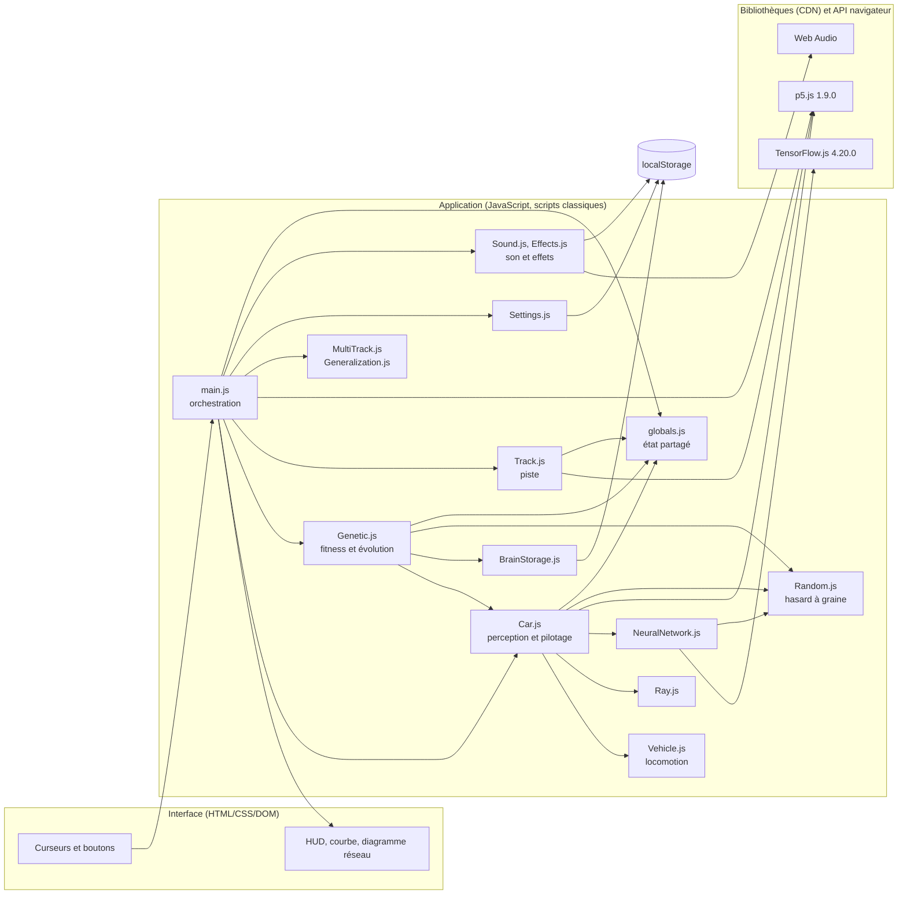
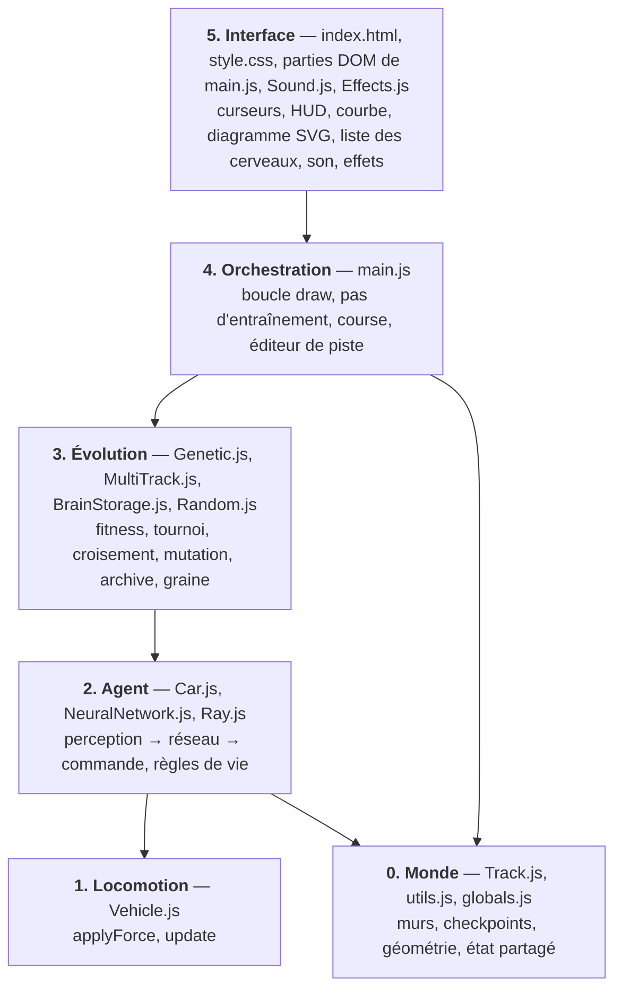
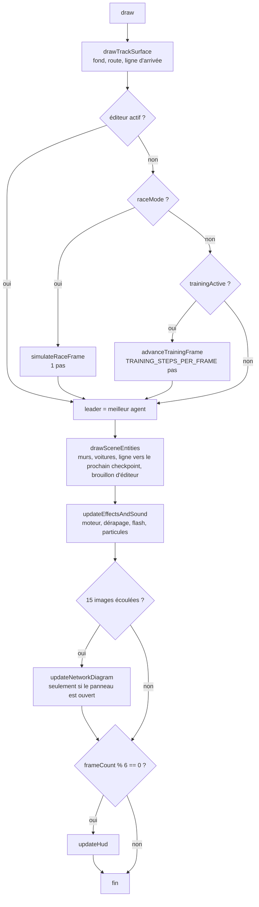
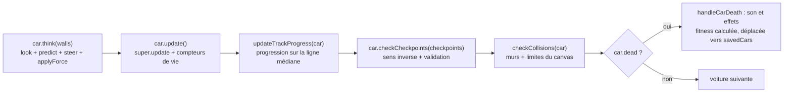
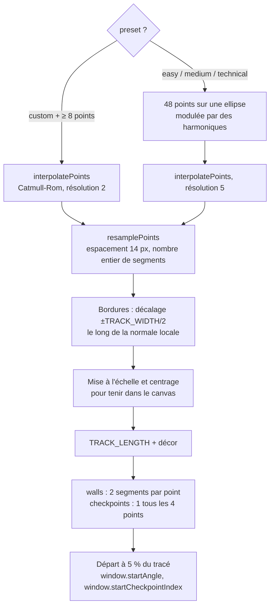
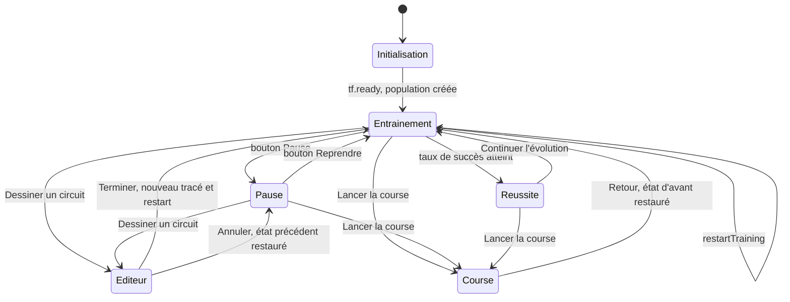
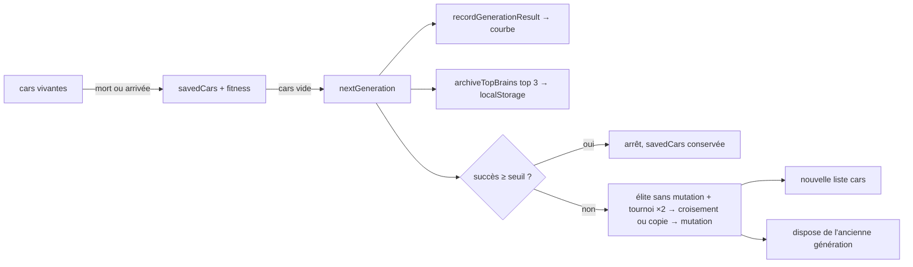
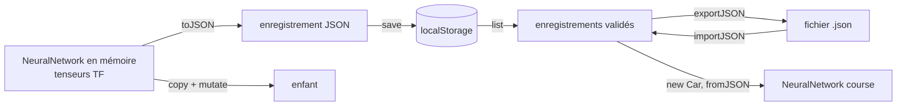
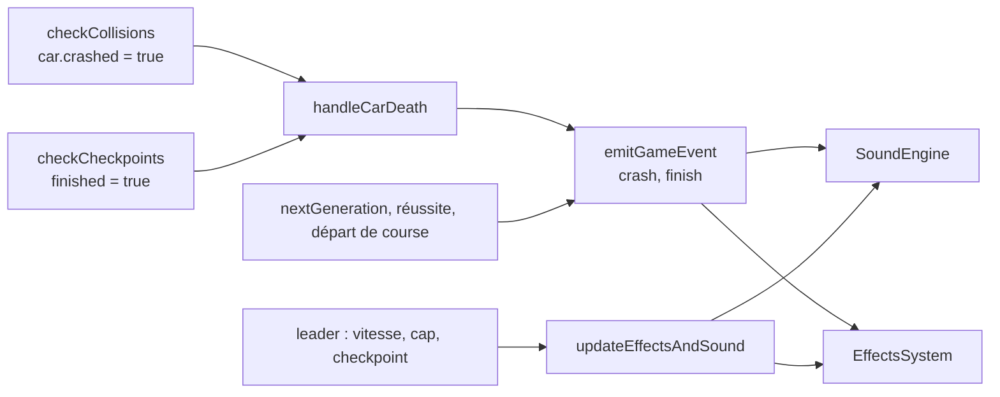

# Neuro Racing — Architecture du projet

> Document de référence sur l'organisation du code, les responsabilités de chaque module, les flux de données et les conventions du projet.
> Il décrit l'état **réel** du code (lu fichier par fichier). Pour le rapport d'utilisation (réglages, protocole d'expérience), voir le [README](../README.md) ; pour l'analyse fonctionnelle, voir [analyse.md](./analyse.md) ; pour le plan de réalisation en tâches numérotées avec leurs critères d'acceptation, voir [SPECIFICATION.md](./SPECIFICATION.md).

---

## Sommaire

1. [Vue d'ensemble](#1-vue-densemble)
2. [Arborescence](#2-arborescence)
3. [Stack technique et chargement](#3-stack-technique-et-chargement)
4. [Architecture en couches](#4-architecture-en-couches)
5. [État global](#5-état-global)
6. [Boucle principale](#6-boucle-principale)
7. [Les modules en détail](#7-les-modules-en-détail)
8. [Machine à états de l'application](#8-machine-à-états-de-lapplication)
9. [Flux de données](#9-flux-de-données)
10. [Formats de données et persistance](#10-formats-de-données-et-persistance)
11. [Interface utilisateur](#11-interface-utilisateur)
12. [Tests](#12-tests)
13. [Conventions et invariants](#13-conventions-et-invariants)
14. [Comment étendre le projet](#14-comment-étendre-le-projet)
15. [Points d'attention constatés](#15-points-dattention-constatés)
16. [Lancer le projet](#16-lancer-le-projet)

---

## 1. Vue d'ensemble

Neuro Racing est une application **100 % navigateur** (aucun serveur, aucune compilation) où une population de voitures apprend à parcourir un circuit fermé par **neuroévolution** : pas de rétropropagation, sélection par tournoi, élitisme, croisement par neurone et mutation gaussienne des poids. Les expériences sont **reproductibles** (hasard à graine), peuvent porter sur **plusieurs circuits** et se comparent en **course** avec chronomètre et verdict « circuit connu / inédit ».

Chaque voiture suit une chaîne en quatre temps, répétée à chaque pas de simulation :

```text
PERCEPTION          DÉCISION             LOCOMOTION           RÈGLES DE COURSE
5 rayons + vitesse → réseau 6 → H → 2  →  force → vitesse   →  collision, checkpoint,
(6 entrées [0,1])    (TensorFlow.js)       → position           stagnation, sens inverse
```

Quand toute la population est éliminée ou a fini, la **fitness** de chaque voiture est calculée, les meilleures servent de parents, leurs réseaux sont copiés puis mutés : c'est la génération suivante.



---

## 2. Arborescence

```text
Neuro_Racing/
├── README.md                         Rapport de projet (usage, réglages, résultats)
├── ARCHITECTURE.md                   Architecture du dépôt d'origine (steering) + annexe Neuro Racing (voir §15.8)
├── AGENTS.md                         Consignes du dépôt d'origine + section « Projet Neuro Racing » (voir §15.8)
├── .vscode/settings.json             Live Server sur le port 5503
├── ARTICLE_CRAIG_REYNOLDS/
│   └── Steering Behaviors For Autonomous Characters.pdf   Référence théorique (GDC 1999)
└── Conduite Évolutive/               ← l'application (racine à servir en HTTP)
    ├── index.html                    Structure DOM + ordre de chargement des scripts
    ├── analyse.md                    Analyse fonctionnelle et technique
    ├── ARCHITECTURE.md               Ce document
    ├── SPECIFICATION.md              Plan de réalisation : 61 tâches numérotées et leurs critères d'acceptation
    ├── css/
    │   └── style.css                 Thème sombre, panneaux flottants, HUD
    ├── js/
    │   ├── globals.js                Paramètres et état partagés (variables globales)
    │   ├── utils.js                  Géométrie : point/segment, segment/segment, segment/rectangle orienté
    │   ├── Random.js                 Hasard à graine (mulberry32) : tirages reproductibles de la simulation
    │   ├── NeuralNetwork.js          Réseau dense TF.js : prédire, copier, muter, JSON
    │   ├── BrainStorage.js           Archive localStorage + import/export JSON
    │   ├── Settings.js               Réglages de l'interface conservés (localStorage)
    │   ├── Sound.js                  Sons synthétisés (Web Audio) et préférences
    │   ├── Effects.js                Particules, confettis, flashs (générateur local)
    │   ├── Ray.js                    Rayon et intersection rayon/segment
    │   ├── Track.js                  Génération et dessin des circuits
    │   ├── Vehicle.js                Locomotion de base (force → vitesse → position)
    │   ├── Car.js                    Vehicle + perception + cerveau + règles de vie
    │   ├── Genetic.js                Fitness, tournoi, génération suivante, archivage
    │   ├── MultiTrack.js             Entraînement multi-circuits : un tour par circuit, moyenne
    │   ├── Generalization.js         Course sur un autre circuit : connu / inédit
    │   └── main.js                   Boucle p5, interface, éditeur de piste, course
    └── tests/                        helpers.cjs + 23 fichiers *.test.cjs (voir §12.2)
        ├── helpers.cjs               Contexte `vm` + adaptateur de vecteur p5
        └── *.test.cjs                brain-storage, crossover, elitism, fitness-progress, generalization,
                                      multi-track(-settings), race-timing, random-seed, settings-storage,
                                      sound-effects, stall-and-editor, track-*, training-speed, tunneling,
                                      vehicle-track, visuals, archive-filter, car-rectangle, defaults,
                                      generation-counter, learning-export
```

> Le dossier de l'application s'appelle `Conduite Évolutive` (avec accent et espace). Dans certaines extractions de ZIP, il apparaît sous la forme `Conduite #U00c9volutive` : c'est un artefact d'encodage, pas le vrai nom.

---

## 3. Stack technique et chargement

| Technologie | Version | Rôle |
|---|---|---|
| JavaScript (ES2022, scripts classiques) | — | Toute la logique, sans bundler ni modules ES |
| p5.js | 1.9.0 (CDN jsDelivr) | Canvas, boucle `setup`/`draw`, `p5.Vector`, dessin, `map`/`constrain`/`random` |
| TensorFlow.js | 4.20.0 (CDN jsDelivr) | Couches denses, `predict`, lecture/écriture des poids |
| HTML + CSS | — | Panneaux, curseurs, HUD ; diagramme réseau en SVG, courbe en `<canvas>` 2D |
| Web Audio | API navigateur | Sons synthétisés (aucun fichier audio) |
| `localStorage` | — | Archive des cerveaux, réglages, préférences de son |
| Node.js ≥ 18 + `node:test` | — | Tests uniquement (aucune dépendance npm) |

### Ordre de chargement (contrainte forte)

Les scripts sont de simples `<script>` : il n'y a ni `import` ni `export`. Tout est dans la portée globale, donc **l'ordre dans `index.html` fait office de graphe de dépendances** :

```text
p5.min.js → tf.min.js
  → globals.js          (variables utilisées par tous les suivants)
  → utils.js
  → Random.js           (hasard à graine : utilisé par NeuralNetwork, Genetic, Car, Settings, main)
  → NeuralNetwork.js    (utilise tf, Random.js)
  → BrainStorage.js     (utilise NeuralNetwork.validateJSON)
  → Settings.js         (lit/écrit les variables de globals.js et les contrôles du DOM)
  → Sound.js            (SoundEngine, Web Audio ; préférences en localStorage)
  → Effects.js          (EffectsSystem ; générateur local, jamais Random.js)
  → Ray.js              (utilise p5 et SIGHT_DIST)
  → Track.js            (utilise globals et p5)
  → Vehicle.js          (classe de base)
  → Car.js              (extends Vehicle ; utilise Ray, NeuralNetwork)
  → Genetic.js          (utilise Car, BrainStorage via main)
  → MultiTrack.js       (utilise Car, setupTrack, trainingPreset ; lit savedCars / cars)
  → Generalization.js   (utilise trainingPreset ; fonctions pures de libellé et de bilan)
  → main.js             (définit setup/draw que p5 appelle automatiquement)
```

Inverser deux scripts casse l'application (par exemple, `Car.js` avant `Vehicle.js` lève une erreur sur `extends`). `main.js` doit rester le dernier : p5 en mode global cherche `setup()` et `draw()` sur `window` au chargement.

---

## 4. Architecture en couches

Le projet suit la séparation de Reynolds (*sélection d'action → steering → locomotion*), étendue d'une couche d'évolution et d'une couche d'interface.



| Couche | Fichiers | Ce qu'elle sait | Ce qu'elle ignore |
|---|---|---|---|
| Monde | `Track.js`, `utils.js`, `globals.js` | Géométrie, murs, checkpoints, paramètres | Les voitures et le réseau |
| Locomotion | `Vehicle.js` | `pos`, `vel`, `acc`, limites | Capteurs, réseau, piste |
| Agent | `Car.js`, `NeuralNetwork.js`, `Ray.js` | Percevoir, décider, score individuel, mort | Population, générations, DOM |
| Évolution | `Genetic.js`, `MultiTrack.js`, `BrainStorage.js`, `Random.js` | Fitness, sélection, élitisme, croisement, archivage, graine, tours multi-circuits | Rendu, physique détaillée |
| Orchestration | `main.js`, `Generalization.js`, `Settings.js` | Tout l'enchaînement et l'état des modes, verdict connu/inédit, réglages persistants | — |
| Interface et décor | `index.html`, `style.css`, `Sound.js`, `Effects.js` | Structure, style, son, effets | Logique métier ; ni son ni effets n'influencent la simulation |

**Règle de frontière importante** : le réseau ne décide que de la *commande* (direction + poussée). La détection de collision, la validation des checkpoints, la progression sur le tracé et la condition de victoire sont des **règles explicites de simulation**, jamais apprises. Le réseau ne peut donc pas « tricher » sur ces règles.

---

## 5. État global

Il n'y a pas d'objet « application » : l'état vit dans des variables globales. Deux endroits :

### 5.1 `globals.js` — déclarées avec `var`

| Groupe | Variables | Rôle |
|---|---|---|
| Constantes d'agent | `NB_ASSETS = 6`, `SIGHT_DIST = 150`, `FOV = π/1.5` (120°) | 5 rayons + 1 vitesse ; portée et champ de vision |
| Population | `TOTAL_POP`, `cars`, `savedCars`, `raceCars`, `generation` | Voitures vivantes, éliminées (génération en cours), en course |
| Monde | `walls`, `checkpoints`, `currentTrackPath`, `currentInnerBoundary`, `currentLandscaping`, `TRACK_LENGTH`, `startX`, `startY` | Sortie de `setupTrack()` |
| Circuit | `TRACK_PRESET`, `TRACK_DIFFICULTY`, `TRACK_WIDTH`, `customTrackPath` | Réglages de géométrie |
| Évolution | `MUTATION_RATE`, `CROSSOVER_RATE` (0,7), `ELITE_COUNT` (1), `SUCCESS_RATE_TARGET`, `HIDDEN_NODES`, `HIDDEN_ACTIVATION` | Réglages d'apprentissage |
| Hasard | `RANDOM_SEED` (`null` = automatique), `activeSeed` | Graine imposée et graine de l'expérience en cours (voir §15.4) |
| Multi-circuits et course | `MULTI_TRACK_TRAINING`, `MULTI_TRACK_SET`, `multiTrackRound`, `currentTrackPreset`, `RACE_TRACK_CHOICE` | Circuits d'entraînement, tour en cours, circuit réellement dessiné, circuit de la course |
| Décor, son, effets | `currentOuterBoundary`, `currentScenery`, `trackLayer`, `soundEngine`, `effects` | Bord extérieur, décor hors piste, calque du décor fixe, moteur de son et système d'effets (créés dans `setup()`) |
| Physique | `GAME_SPEED_LIMIT` (= `maxSpeed`), `CAR_ACCELERATION` (= `maxForce`), `TRAINING_STEPS_PER_FRAME` | Réglages de locomotion |
| Modes | `trainingActive`, `trainingFinished`, `raceMode`, `trackEditorActive`, `showDebugSensors` | Drapeaux d'état (voir §8) |
| Chronomètre de course | `raceFrames`, `RACE_FPS = 60` | Images simulées depuis le départ de la course ; 60 images = 1 s. Remis à 0 au départ et à la sortie de course |
| Suivi | `learningHistory`, `generationStartedAt`, `trainedBrains`, `currentNetworkLeader` | Statistiques et archive en mémoire |

`var` est choisi volontairement : il rend les variables accessibles via `window` et, surtout, permet aux tests de les lire/écrire dans un contexte `vm`.

`Track.setupTrack()` écrit aussi deux **variables sur `window`** que `Car` relit à la création : `window.startAngle` (cap initial) et `window.startCheckpointIndex` (premier checkpoint visé).

### 5.2 En tête de `main.js` — déclarées avec `let`

`brainStorage` (instance), `settingsStorage` (réglages persistants), `selectedBrainIds` (Set des cases cochées), `raceResultsShown`, `trainingStateBeforeRace` (sauvegarde de l'état avant une course), `brainArchiveAvailable`, `networkRefreshFrames` (compteur de rafraîchissement du diagramme), `raceTrackSwapped` (la course se déroule sur un autre circuit que l'entraînement). Constantes : `RACE_BOARD_ROWS = 8`, `RACE_BOARD_REFRESH_FRAMES = 6`, `FX_SKID_TURN`, `FX_FAST_FORWARD_STEPS = 3`.

---

## 6. Boucle principale

p5 appelle `draw()` à chaque image (~60 Hz). Dans `main.js` :



Points de conception :

- **Découplage rendu / simulation** : `TRAINING_STEPS_PER_FRAME` (1 à 10) répète le pas de simulation avant le rendu suivant. C'est ce curseur qui accélère l'entraînement ; la course reste à 1 pas par image.
- **Rafraîchissements espacés** : HUD toutes les 6 images, diagramme réseau toutes les 15 images (et seulement si le panneau est ouvert et que le leader a changé), pour limiter le travail DOM.
- **Décor mis en cache** : le décor fixe (herbe, route, décor extérieur) est peint une seule fois dans `trackLayer` ; `drawTrackSurface()` ne fait que le recopier à chaque image.
- **Son et effets** : `updateEffectsAndSound(leader)` est appelée **une fois par image affichée**, pas à chaque pas de simulation. Au-delà de `FX_FAST_FORWARD_STEPS` (3) cycles par image, l'entraînement accéléré est silencieux.
- **Unités** : toute la physique est **par image/pas**, sans `deltaTime`. Les seuils (60 pas, 120 pas, 1 200 pas…) sont des pas de simulation, pas des secondes.

### 6.1 Un pas d'entraînement (`simulateTrainingStep`)

Pour chaque voiture vivante, **dans cet ordre exact** :



Quand `cars` est vide : `nextGeneration()` puis `generation++`, sauf si l'objectif est atteint (`trainingFinished`) : aucune nouvelle population n'existe alors, et `continueTrainingFromArchive()` incrémentera à la reprise. En mode multi-circuits, quand la dernière voiture d'un **tour** est hors course, `advanceMultiTrackRound()` s'intercale (voir §7.6 bis) : `nextGeneration()` n'est appelée qu'après le dernier circuit.

La boucle itère de la fin vers le début (`for i = length-1 → 0`) pour pouvoir retirer un élément avec `splice` sans décaler les indices restants.

---

## 7. Les modules en détail

### 7.1 `Vehicle.js` — locomotion

Classe minimale : `pos`, `vel`, `acc`, `maxSpeed`, `maxForce`.

| Méthode | Comportement |
|---|---|
| `applyForce(f)` | `acc += f` (les forces s'accumulent) |
| `update()` | Ne fait rien si `dead`. Sinon : `vel += acc` → `vel.limit(maxSpeed)` → `pos += vel` → `acc = 0` |

Le réseau ne produit jamais de coordonnées : il influence l'accélération, et `update()` intègre une seule fois par pas.

### 7.2 `Car.js` — l'agent (`Car extends Vehicle`)

**Construction.** `new Car(config)` accepte :

- rien → réseau neuf (`NB_ASSETS`, `HIDDEN_NODES`, 2, `HIDDEN_ACTIVATION`) ;
- un `NeuralNetwork` → **copie** (`brain.copy()`) ;
- `{ brain, position, color, name }` où `brain` est un `NeuralNetwork` ou son JSON (→ `NeuralNetwork.fromJSON`).

Le constructeur vérifie que le cerveau a bien 6 entrées et 2 sorties, sinon il lève une erreur. La position par défaut est `(startX, startY)` avec un jitter de ±3 px ; le cap vient de `window.startAngle`.

**État individuel** :

| Champ | Rôle |
|---|---|
| `dead`, `finished`, `laps` | Cycle de vie |
| `crashed` | `true` si la mort vient d'un choc (mur ou sortie du canvas), pas d'un blocage : c'est ce drapeau qui déclenche son et effets de collision |
| `lastStepPos`, `startPos` | Position avant le pas (collision balayée) et point de départ (rejoué par l'élite et par les tours multi-circuits) |
| `trail` | Traînée du leader : une position tous les 2 pas, 26 points au plus |
| `lapFrames` | Temps de tour : valeur de `frameCount` à l'arrivée (`null` tant que la voiture n'a pas fini). Se convertit en secondes avec `RACE_FPS` |
| `score` | +50 par checkpoint, +200 à la fin du tour |
| `fitness` | Calculée par `scoreCarFitness()` (Genetic.js) |
| `checkpointIndex` | Prochain checkpoint à valider |
| `frameCount`, `framesStalled`, `framesMovingSlowly`, `windowPath`, `prevPos`, `framesSinceLastCheckpoint`, `wrongWayCount` | Compteurs anti-blocage |
| `trackProgress`, `trackProgressIndex` | Distance parcourue le long de la ligne médiane |
| `speedTotal`, `speedSamples` | Vitesse moyenne (utilisée dans la fitness) |
| `rays[5]` | Instances `Ray` réutilisées à chaque pas |

**Méthodes clés :**

- `look(walls)` — pour chacun des 5 rayons, orienté à `heading - FOV/2 + i·FOV/4` (le cap est celui de la vitesse), cherche l'intersection la plus proche avec tous les murs, bornée à `SIGHT_DIST`. L'entrée vaut `map(distance, 0, 150, 1, 0)` : mur collé → 1, rien dans la portée → 0. La 6ᵉ entrée est `‖vel‖ / maxSpeed`.
- `think(walls)` — `look` → `brain.predict` → conversion des sorties :
  - `turnForce = map(sortie0, 0, 1, -maxForce, +maxForce)` (ajouté au cap, en radians) ;
  - `thrust = map(sortie1, 0, 1, 0, maxSpeed)`, avec un plancher à `0.5·maxSpeed` pendant les 30 premiers pas (aide au démarrage, pas apprise) ;
  - `desiredVel = fromAngle(cap + turnForce)` de norme `thrust` ; `steer = desiredVel − vel`, limité à `maxForce` ; `applyForce(steer)`.
- `update()` — incrémente `frameCount` ; **au pas 60**, élimine la voiture si elle est restée à moins de 40 px de son départ ; mémorise `lastStepPos` puis appelle `super.update()` ; alimente la traînée et la vitesse moyenne ; applique les règles de stagnation, y compris la détection des rotations en cercle (voir tableau ci-dessous).
- `checkCheckpoints(cps)` — (1) détection de **sens inverse** à partir du pas 100 : compare `vel` à la direction locale du circuit (centre du checkpoint visé → centre du suivant) ; produit scalaire < −0.3 → `wrongWayCount++` ; > 0.2 → décrémente de 5 ; plus de 100 → mort. (2) **Validation** : si la distance au segment du checkpoint visé est < 40 px, `checkpointIndex` avance, +50 points, compteurs remis à zéro. Si l'index revient à 0, le tour est fini : +200, `finished = true`, `dead = true`.
- `show(isBest, drawRays)` — dessine le rectangle 20×10 orienté selon la vitesse ; masque les voitures mortes sauf le leader (affiché en rouge translucide) ; trace les rayons en mode debug.
- `parseHexColor()`, `shadeColor()` — aides de rendu (couleurs de la monoplace) ; sans effet sur la simulation.
- `setPhysics(maxSpeed, maxForce)`, `mutate(rate)`, `dispose()` — délèguent au cerveau ou modifient les limites en direct.

**Règles d'élimination** (toutes en pas de simulation) :

| Règle | Condition | Où |
|---|---|---|
| Départ raté | au pas 60, distance au départ < 40 px | `Car.update` |
| Stagnation | fenêtres de 60 pas : fenêtre **ratée** (`framesStalled += 60`) si le déplacement **net** est < 20 px (sur place) **ou** si le chemin parcouru dépasse 60 px alors que le déplacement net est < 30 % de ce chemin (voiture qui tourne en rond, même sur un grand cercle) ; au-delà de 120 (3ᵉ fenêtre consécutive) → mort. Une fenêtre réussie remet à 0. | `Car.update` |
| Pas de checkpoint | > 1 200 pas depuis le dernier | `Car.update` |
| Sens inverse | `wrongWayCount` > 100 | `Car.checkCheckpoints` |
| Mur | le **trajet du pas** (`lastStepPos → pos`) passe à moins de `width / 1.8` (≈ 5,6 px) d'un mur (collision balayée), **ou** le **rectangle de la voiture** (20 × 10, orienté selon la vitesse, comme dessiné) touche le mur à sa position d'arrivée (`segmentHitsOrientedRect`) | `main.checkCollisions` |
| Hors canvas | `pos` hors de `[0,width] × [0,height]` | `main.checkCollisions` |
| Arrivée | dernier checkpoint validé | `Car.checkCheckpoints` |

### 7.3 `NeuralNetwork.js` — le cerveau

Enveloppe autour d'un `tf.sequential` de deux couches `dense` :

```text
Entrée (6)  ──dense(H, activation ∈ {sigmoid, tanh, relu})──  Cachée (H)  ──dense(2, sigmoid)──  Sortie (2)
```

Nombre de paramètres : `6H + H + 2H + 2 = 9H + 2` (182 pour H = 20).

| Méthode | Détail |
|---|---|
| `predict(inputs)` | `tf.tidy` : crée un tenseur 2D, lance le modèle, lit avec `dataSync()`, renvoie un tableau JS. `tidy` libère les tenseurs intermédiaires. |
| `copy()` | Construit un second modèle, y recopie des **clones** des poids, libère les tenseurs temporaires (`finally`). |
| `mutate(rate)` | Lit chaque tenseur de poids, pour chaque valeur : si `Math.random() < rate`, ajoute `randomGaussian(0, 0.1)`. Reconstruit les tenseurs et appelle `setWeights`. |
| `toJSON()` / `fromJSON()` | Sérialisation complète (voir §10). |
| `validateJSON(data)` | Vérifie entiers, activation connue, **4 tenseurs**, formes exactes `[in,H]`, `[H]`, `[H,out]`, `[out]`, tailles et valeurs finies. |
| `dispose()` | Libère le modèle TF. **À appeler pour toute voiture supprimée** (la mémoire des tenseurs n'est pas gérée par le ramasse-miettes JS). |

`NeuralNetwork.crossover(a, b)` (statique) combine deux parents de même architecture **par neurone caché** : chaque neurone est hérité d'un seul parent avec ses poids d'entrée, son biais et ses poids de sortie ; le biais de chaque sortie est tiré séparément. Les parents sont intacts et l'enfant, nouveau réseau, doit être libéré par l'appelant. Architecture différente : copie du premier parent.

### 7.4 `Ray.js` — capteur

| Élément | Détail |
|---|---|
| `constructor(pos, angle)` | Position et direction unitaire (`p5.Vector.fromAngle`) |
| `setPos(x, y)`, `setDir(angle)` | Mise à jour à chaque pas (les 5 instances sont réutilisées) |
| `cast(wall)` | Intersection rayon / segment par la formule des déterminants. Retourne un point si `0 < t < 1` (sur le segment) et `u > 0` (devant le rayon), sinon `undefined`. |
| `show(distance, color)` | Dessin de debug : trait, point d'impact, distance en px |

### 7.5 `Track.js` — le monde

**Classe `Boundary`** : segment `a → b` avec un `type` (`"wall"` ou `"checkpoint"`) et un `segmentIndex` (alternance blanc/rouge des bordures). Les coordonnées `NaN` sont neutralisées.

**`setupTrack()` — pipeline de construction** (appelée au démarrage, au redimensionnement, à chaque changement de circuit, de largeur ou de difficulté) :



Formes des presets (`d = TRACK_DIFFICULTY / 50`, `θ` angle sur l'ellipse) :

| Preset | Perturbation du rayon |
|---|---|
| `easy` | `d · 0.035 · cos(2θ)` |
| `medium` | `(0.08 + 0.08d) · cos(3θ)` |
| `technical` | `(0.15 + 0.12d) · cos(5θ) + (0.04 + 0.04d) · sin(3θ)` |

Si moins de 8 points sont produits, le code retombe sur `easy` (récursion).

**Fonctions de dessin** : `drawTrackSurface` recopie à chaque image un calque `trackLayer` (p5.Graphics) peint une seule fois par `paintTrackScene` (herbe rayée, infield, décor extérieur `currentScenery`, gravier, asphalte, vibreurs, ligne d'arrivée avec portique, vignettage). Le calque est invalidé par `setupTrack()`. Les murs de collision ne sont retracés qu'en mode debug ; `Car.show` dessine une monoplace (ailerons, roues, cockpit, feux de freinage), avec halo et traînée pour le leader.

**Géométrie utilitaire** : `isInsidePolygon` (lancer de rayon pair/impair, sert au placement des arbres) ; `distanceToCenterline` (distance à la ligne médiane, pour tenir le décor à l'écart de la piste).

**Circuit dessiné (éditeur).** `findLoopSelfIntersection(points)` détecte une auto-intersection d'une boucle fermée (`doSegmentsIntersect`, voisins ignorés). `closeDraftLoop(points)` referme proprement un trait qui dépasse un peu son point de départ : le bout en trop est coupé et la boucle se referme sur le point de croisement (`segmentIntersectionPoint`). Un vrai croisement au milieu du tracé (boucle en « 8 ») n'est pas corrigé et reste refusé par `finishTrackEditor()`.

**Circuit de l'entraînement.** `trainingPreset()` renvoie le circuit sur lequel l'entraînement tourne (celui du tour en cours en multi-circuits) ; `setupTrack(preset = trainingPreset())` construit n'importe quel circuit sans toucher à `TRACK_PRESET`.

**Décor extérieur.** `createOuterScenery()` pose arbres, pins, buissons, rochers et fleurs de façon **déterministe** (`sceneryNoise`), hors piste et hors de ses dégagements, triés de l'arrière vers l'avant ; `setupTrack()` stocke aussi `currentOuterBoundary` (vibreurs) et invalide `trackLayer`.

### 7.6 `Genetic.js` — évolution

| Fonction | Rôle |
|---|---|
| `scoreCarFitness(car)` | Combine score et signaux de progression (formule ci-dessous) |
| `calculateFitness()` | Recalcule la fitness de toutes les voitures de `savedCars` |
| `tournamentSelection(pop)` | Tire `min(5, taille)` individus **au hasard (avec remise)** et garde la meilleure fitness |
| `nextGeneration()` | Fitness → taux de succès → historique → archive top 3 → test d'arrêt → sinon nouvelle population |
| `archiveTopBrains(list, n, { onlyProgressed })` | Trie par fitness, crée un enregistrement JSON par voiture et le sauve via `BrainStorage`. Avec `onlyProgressed: true` (archivages automatiques), ignore les voitures sans checkpoint validé (`score` = 0) et non terminées |
| `currentTrackLength()` | `TRACK_LENGTH`, ou recalcul depuis la ligne médiane |

**Formule de fitness** :

```text
fitness = score
        + 0.12 · min(trackProgress, longueurPiste)
        + 8    · vitesseMoyenne
        − 0.7  · framesStalled
        − 0.04 · max(0, framesSinceLastCheckpoint − 120)
        − 0.35 · wrongWayCount
        + 0.5  · max(0, map(distanceAuProchainCheckpoint, 0 → 400, 50 → 0))
```

**`nextGeneration()`, étape par étape :**

1. `calculateFitness()` sur `savedCars` (toute la génération qui vient de finir).
2. `successRate = voitures finished / population`.
3. `recordGenerationResult()` (main.js) : moyenne, meilleur score, vitesse, durée → `learningHistory` (250 entrées max) et courbe.
4. `archiveTopBrains(savedCars, 3, { onlyProgressed: true })`.
5. Si `successRate ≥ SUCCESS_RATE_TARGET` → `trainingFinished = true`, `trainingActive = false`, retour (la population `savedCars` est conservée pour « Continuer l'évolution »).
6. Sinon : `buildNextPopulation()` — élites sans mutation, puis pour chaque enfant restant `createChild()` : avec la probabilité `CROSSOVER_RATE`, deux parents distincts (deux tournois) → `NeuralNetwork.crossover` → `new Car(cerveauCroisé)` (copie) → `dispose()` de l'intermédiaire ; sinon → `new Car(parent.brain)` (copie d'un seul parent) ; puis `mutate(MUTATION_RATE)` → `setPhysics`. Puis `dispose()` de toute l'ancienne génération et `savedCars = []`.

**Élitisme** : `buildNextPopulation()` reconduit d'abord les `ELITE_COUNT` (1) meilleurs cerveaux **sans mutation**, avec leur point de départ d'origine (`startPos`) pour rejouer exactement le même tour ; les places restantes sont remplies par tournoi → copie → mutation. `nextGeneration()` et `continueTrainingFromArchive()` passent par cette fonction.

### 7.6 bis `MultiTrack.js` et `Generalization.js` — plusieurs circuits

**Entraînement multi-circuits** (`MULTI_TRACK_TRAINING`, `MULTI_TRACK_SET`, `multiTrackRound` dans `globals.js`). `simulateTrainingStep()` appelle `advanceMultiTrackRound()` quand la dernière voiture d'un tour est hors course :

1. chaque voiture reçoit le résumé de son tour (`summarizeRound`, dans `car.roundResults`) ;
2. s'il reste un circuit : `setupTrack(circuit suivant)`, puis `respawnOnCurrentTrack()` recrée chaque voiture (même cerveau, même décalage de départ par rapport au départ du circuit, mêmes couleur et nom, résultats reportés) ; l'ancienne voiture est libérée (`dispose`) ;
3. au dernier tour : `applyAggregatedResults()` écrit sur chaque voiture la moyenne des tours (`score`, `fitness`, `trackProgress`) et `finished` = a bouclé tous les circuits ; `aggregateFitness` empêche `calculateFitness()` de recalculer la fitness sur le seul dernier circuit ; `nextGeneration()` s'exécute ensuite normalement ;
4. `beginMultiTrackGeneration()` ramène la nouvelle population sur le premier circuit (aussi à la reprise après une réussite).

`restartTraining()` remet toujours `multiTrackRound` à 0. `trainingPreset()` (dans `Track.js`) donne le circuit sur lequel l'entraînement tourne ; `setupTrack(preset = trainingPreset())` construit n'importe quel circuit sans modifier `TRACK_PRESET` et renseigne `currentTrackPreset` (le circuit réellement dessiné).

**Course sur un autre circuit.** `RACE_TRACK_CHOICE` (`"auto"` ou un circuit) donne le circuit de la course ; `startBrainRace()` redessine ce circuit seulement s'il diffère du circuit courant, puis lit le départ ; `exitBrainRace()` redessine `trainingPreset()` si le circuit avait été changé (`raceTrackSwapped`). Les voitures de course reçoivent `trainedOn` et `circuitStatus` (`seen` / `unseen` / `unknown`, calculé par `Generalization.js`).

### 7.7 `BrainStorage.js` — persistance

Classe injectable (`new BrainStorage(storage = localStorage)`), ce qui la rend testable avec un faux stockage.

| Élément | Détail |
|---|---|
| Clé | `"neuroevolution-racing-brains-v1"` |
| Capacité | 40 enregistrements, plus récents en tête (`unshift`, puis `slice(0, 40)`) |
| `list()` | Lecture **tolérante et sans écriture** : renvoie les entrées valides, ne lève plus d'erreur sur une archive abîmée et ne la modifie jamais (`isCorrupted()` indique si elle l'est). `inspect()` fournit le détail `{records, corrupted, raw}` |
| `save(record)` | Valide, retire un éventuel doublon d'`id`, insère en tête. Lit via `listForWrite()` : si l'archive est abîmée, sa **copie brute est d'abord sauvegardée** sous `neuroevolution-racing-brains-v1-corrupted-backup`, puis ses entrées valides sont reprises (`recoveredFromCorruption`, `backupSaved`) |
| `repair()` / `getCorruptedBackup()` | `repair()` sauvegarde la copie brute puis réécrit l'archive avec ses seules entrées valides ; appelée par `loadBrainArchive()` au démarrage si `isCorrupted()`. `getCorruptedBackup()` renvoie le texte brut de la dernière sauvegarde (ou `null`). Si la sauvegarde échoue (quota), l'écriture a lieu quand même et `backupSaved` vaut `false`. `clear()` efface aussi la sauvegarde |
| `exportJSON()` / `importJSON(text)` | Format enveloppé `{format, version, brains}` ; l'import valide tout, fusionne, dédoublonne par `id` et respecte la limite. Si l'archive locale est corrompue, l'import ne plante pas : ses entrées valides sont gardées après sauvegarde de la copie brute |
| `commit(records)` / `restore(previous)` | **Unique point d'écriture** de la clé principale : `save()`, `importJSON()` et `repair()` passent tous par `commit()`. Il valide chaque entrée, relit et revalide le texte sérialisé (un `NaN` devenu `null` est refusé), écrit, relit la valeur stockée et la compare. Au moindre échec (quota, écriture tronquée, valeur relue différente), `restore()` remet l'ancienne valeur et l'erreur est propagée : une écriture ne peut donc ni laisser une archive invalide ni la laisser à moitié écrite |
| `clear()` | Supprime la clé |
| `validateRecord(r)` | `id` et `name` chaînes, `score` fini, `brain` valide (délègue à `NeuralNetwork.validateJSON`) |

### 7.8 `main.js` — orchestrateur (≈ 1 600 lignes)

Le fichier regroupe plusieurs responsabilités. Repères pour s'y retrouver :

| Bloc | Fonctions principales |
|---|---|
| **Cycle p5** | `setup`, `draw`, `windowResized` |
| **Simulation** | `advanceTrainingFrame`, `simulateTrainingStep`, `simulateRaceFrame`, `checkCollisions` (collision balayée + rectangle de la voiture), `updateTrackProgress` |
| **Son et effets** | `emitGameEvent`, `handleCarDeath`, `updateEffectsAndSound`, `bindSoundControls` |
| **Graine** | `beginExperimentSeed`, `updateSeedDisplay`, `applySeedFromInput`, `replaySeed` |
| **Leader / classement** | `findTrainingLeader`, `getRaceLeader`, `distanceToNextCheckpoint`, `displayRaceResults` |
| **Rendu de scène** | `drawSceneEntities` (murs, voitures, debug, ligne vers le checkpoint visé) |
| **HUD et graphiques** | `updateHud`, `recordGenerationResult`, `learningChartSeries`, `drawLearningChart`, `learningHistoryToCsv`, `exportLearningCurve`, `updateNetworkDiagram` (SVG construit à la main) |
| **Éditeur de piste** | `beginTrackEditor`, `addTrackDraftPoint`, `isCanvasEvent`, `mousePressed`, `mouseDragged`, `drawTrackEditorDraft`, `polygonArea`, `showEditorMessage`, `finishTrackEditor`, `cancelTrackEditor`, `resetTrackEditor` |
| **Contrôles** | `bindControls`, `bindAnalysisPanels`, `bindRange` |
| **Contrôle d'entraînement** | `toggleTraining`, `updateTrainingButton`, `continueTrainingFromArchive`, `restartTraining`, `updatePhysics` |
| **Archive et course** | `saveCurrentTop`, `loadBrainArchive`, `renderBrainList`, `startBrainRace`, `exitBrainRace`, `simulateRaceFrame`, `getRaceLeader`, `rankRaceCars`, `refreshRaceTimer`, `refreshRaceRanking`, `displayRaceResults`, `exportBrains`, `importBrains`, `clearBrainArchive` |
| **Circuits** | `displayedPreset`, `trackLabel`, `syncMultiTrackControls`, `chooseRaceTrack` |
| **Utilitaires** | `setStatus`, `formatElapsedTime`, `formatRaceTime` |

**Détails à connaître :**

- `setup()` crée le canvas plein écran, le moteur de son et les effets, restaure les réglages persistants, construit la piste, branche les contrôles, charge l'archive, fixe la graine (`beginExperimentSeed()`), puis attend `tf.ready()` avant de créer la première population. Tant que TF n'est pas prêt, `cars` est vide et l'entraînement inactif.
- `checkCollisions(car)` pose `car.crashed = true` quand la mort vient d'un choc (mur ou sortie du canvas) ; c'est la seule source du son et des effets de collision.
- `updateTrackProgress(car)` cherche le point de la ligne médiane le plus proche (parcours linéaire), calcule l'avancée en nombre de points, et n'ajoute à `trackProgress` que si le mouvement est **vers l'avant** (produit scalaire avec la tangente ≥ 0) et inférieur à la moitié du circuit. Un recul décrémente la progression (jamais sous 0).
- `findTrainingLeader()` : un seul passage sur la population (pas de tri), départage les égalités de fitness par distance au prochain checkpoint. Si plus aucune voiture n'est vivante, retombe sur `savedCars`.
- `restartTraining(message)` est le **point de réinitialisation unique** : quitte la course sans reprise, **archive le top 5** de `cars ∪ savedCars` (uniquement les voitures qui ont progressé : un redémarrage au tout début n'archive rien), libère tous les cerveaux, recrée une population neuve, remet à zéro génération, historique et affichages.

### 7.9 `utils.js` — géométrie

| Fonction | Rôle |
|---|---|
| `distPointToSegment(p, a, b)` | Distance d'un point à un segment (projection bornée à [0, 1]), sans muter les entrées |
| `distSegmentToSegment(p1, p2, q1, q2)` | 0 si les deux segments se croisent, sinon l'écart minimal : sert à la collision balayée du trajet d'un pas |
| `segmentHitsOrientedRect(a, b, center, heading, halfLength, halfWidth)` | Segment contre rectangle orienté : sert à la collision avec la voiture (20 × 10) telle que dessinée |

### 7.10 `Random.js` — hasard à graine

Générateur mulberry32 (`SeededRandom`), `parseSeed()` (entier de 0 à 2³² − 1, sinon `null`), `drawRandomSeed()`, `seedRandom()`, `randomUnit()`, `randomBetween()`, `randomIndex()`, `randomGaussianValue()` (Box-Muller) et `nextInitSeed()`. Voir §15.4 pour les choix de conception et les limites.

### 7.11 `Settings.js` — réglages persistants

`SETTING_DEFINITIONS` décrit chaque réglage (contrôle HTML, variable globale, format d'affichage, bornes lues dans `index.html`) : vitesse, force, cycles par image, population, mutation, croisement, seuil de réussite, neurones, activation, circuit prédéfini, complexité, largeur, entraînement multi-circuits (case et trois cases de circuit), circuit de la course, graine et debug. `SettingsStorage` lit de façon tolérante (absent, JSON illisible, mauvais format, stockage bloqué → aucun réglage) et écrit sans exception si le quota ou le mode privé la refuse. `restoreSettings()` valide chaque valeur et l'applique **avant** `setupTrack()` et la création des voitures, sans redémarrer l'entraînement ; `persistSettings()` est appelée après chaque changement du panneau. Le circuit dessiné n'est pas conservé (le dernier circuit prédéfini l'est) ; ni la pause ni les panneaux repliés ne sont mémorisés.

### 7.12 `Sound.js` — son synthétisé

`SoundEngine` produit tous les sons avec Web Audio ; **aucun fichier audio** n'est chargé. Un seul moteur « vivant » (celui du leader, hauteur = vitesse) et des sons ponctuels : collision, checkpoint, dérapage, arrivée, nouvelle génération, fanfare de réussite, départ de course, clic.

| Point | Détail |
|---|---|
| Déverrouillage | Le contexte audio n'est créé qu'au premier geste de l'utilisateur (`unlock()`) ; avant, toutes les méthodes sont des no-op silencieux |
| Coupure | Désactiver le son coupe tout le mix (moteur arrêté et déconnecté, volume maître à 0) ; un volume nul ne crée aucune source |
| Voix | Au plus 16 sons ponctuels simultanés (`SOUND_MAX_VOICES`) ; `throttle()` espace les répétitions |
| Préférences | `{ enabled, volume, effects }` validées par `sanitizeSoundPrefs()`, enregistrées sous la clé `neuroRacingSoundPrefs`, **à part** des réglages de simulation ; stockage refusé → valeurs par défaut sans erreur |
| Hasard | Le son ne tire jamais dans le générateur à graine |

### 7.13 `Effects.js` — effets visuels

`EffectsSystem` gère étincelles et débris, fumée de pneus, ondes de choc, confettis, flash des checkpoints (`gateFlash`) et flash d'écran. Ce sont de purs effets de décor : ils ne se déplacent pas dans le monde simulé, n'interagissent avec aucune voiture ni aucun mur et ne participent à aucune décision. Au plus 600 particules (`EFFECTS_MAX_PARTICLES`, les plus anciennes sont éliminées) ; le générateur est **local**, à graine fixe (LCG), et n'appelle jamais `Random.js` : les effets ne changent pas la reproductibilité. `update()` est appelée une fois par image affichée, `draw()` ne fait que dessiner.

`main.js` les relie à la simulation par `emitGameEvent(type, data)` (types `crash`, `finish`, `success`, `generation`, `raceStart`) : `handleCarDeath()` émet `finish` si la voiture a fini, `crash` si `car.crashed`, rien pour une élimination par blocage ; `updateEffectsAndSound(leader)` pilote le moteur, la fumée et le son de dérapage (rotation du cap > `FX_SKID_TURN` à plus de la moitié de la vitesse max) et le flash du checkpoint validé.

---

## 8. Machine à états de l'application

Les « modes » ne sont pas un champ unique mais une combinaison de drapeaux (`trainingActive`, `trainingFinished`, `raceMode`, `trackEditorActive`). Vue logique :



Mécanismes de sauvegarde d'état :

- `trackEditorPreviousState` mémorise `{trainingActive, trainingFinished}` à l'entrée dans l'éditeur ; « Annuler » le restaure.
- `trainingStateBeforeRace` fait de même pour la course ; `exitBrainRace(resumeTraining)` le relit.
- En mode multi-circuits, « Terminer » dans l'éditeur **ne relance pas** l'entraînement : l'état d'avant est restauré, le circuit dessiné devient le circuit de la course (`chooseRaceTrack("custom")`) et sert de circuit inédit pour tester les cerveaux archivés.
- Dans la course, l'entraînement est suspendu (`trainingActive = false`) : les générations n'avancent pas.
- **Chronomètre et classement.** `simulateRaceFrame()` incrémente `raceFrames` tant qu'au moins une voiture roule ; le chronomètre est donc en images simulées (pas l'horloge du navigateur), se fige à la fin de la course ou quand l'éditeur de piste met la simulation en pause, et reste comparable d'un ordinateur à l'autre. Chaque voiture garde son temps de tour (`Car.lapFrames`). `rankRaceCars()` classe les arrivées au temps croissant (égalité de temps = même rang), puis les autres voitures par score et proximité du prochain checkpoint ; `getRaceLeader()` suit la même règle en un seul passage. Le classement (`#raceRanking`, 8 lignes maximum) est redessiné toutes les `RACE_BOARD_REFRESH_FRAMES` = 6 images et à chaque arrivée, une dernière fois à la fin de la course, jamais en boucle ensuite.

---

## 9. Flux de données

### 9.1 D'une observation à un déplacement

```text
walls[] ─┐
         ├─► Ray.cast ×5 ─► distances (px) ─► map → [1…0]  ─┐
pos, vel ┘                                                    ├─► inputs[6]
                              ‖vel‖ / maxSpeed ──────────────┘        │
                                                                      ▼
                                              NeuralNetwork.predict (TF.js) → [s0, s1] ∈ [0,1]²
                                                                      │
                        s0 → ±maxForce (rad) ─► cap désiré            │
                        s1 → 0…maxSpeed      ─► poussée               ▼
                                              desiredVel − vel → limit(maxForce) → applyForce
                                                                      │
                                              Vehicle.update : vel += acc, limit, pos += vel
```

### 9.2 D'une génération à la suivante



### 9.3 Cycle de vie d'un cerveau



### 9.4 Des événements de simulation au son et aux effets



Le flux est à sens unique : la simulation émet des événements, le son et les effets les consomment ; rien ne revient vers la simulation.

---

## 10. Formats de données et persistance

### 10.1 Cerveau sérialisé (`NeuralNetwork.toJSON()`)

```json
{
  "inputNodes": 6,
  "hiddenNodes": 20,
  "outputNodes": 2,
  "activation": "sigmoid",
  "weights": [
    { "shape": [6, 20], "values": [ "… 120 nombres …" ] },
    { "shape": [20],    "values": [ "… 20 biais …" ] },
    { "shape": [20, 2], "values": [ "… 40 nombres …" ] },
    { "shape": [2],     "values": [ "… 2 biais …" ] }
  ]
}
```

L'ordre des 4 tenseurs est imposé : noyau couche cachée, biais caché, noyau sortie, biais sortie. `validateJSON` refuse tout autre agencement.

### 10.2 Enregistrement d'archive (créé par `archiveTopBrains`)

```json
{
  "id": "1760600000000-12-0-k3f9a1",
  "name": "G12 · score 450",
  "createdAt": "2026-10-16T10:00:00.000Z",
  "generation": 12,
  "score": 450,
  "fitness": 612.4,
  "finished": false,
  "trackProgress": 2210.8,
  "trackPreset": "easy",
  "trainedOn": ["easy"],
  "maxSpeed": 6,
  "acceleration": 0.5,
  "brain": { "…": "voir 10.1" }
}
```

Champs obligatoires pour `validateRecord` : `id` (chaîne), `name` (chaîne), `score` (nombre fini), `brain` (valide).

`trainedOn` liste les circuits sur lesquels la lignée du cerveau a été entraînée (`["easy"]` en circuit unique, les circuits cochés en multi-circuits, où `trackPreset` vaut alors `"multi"`). Le champ est facultatif : `validateRecord` ne l'exige pas et `trainedOnPresets()` (`Generalization.js`) ignore les valeurs inconnues et retombe sur `trackPreset` pour une archive ancienne ; sans historique, la course n'affiche ni « connu » ni « inédit ».

### 10.3 Fichier d'export

```json
{ "format": "neuroevolution-brains", "version": 1, "brains": [ "…enregistrements…" ] }
```

### 10.4 Où est écrit quoi

| Donnée | Support | Durée de vie |
|---|---|---|
| Archive des cerveaux | `localStorage`, clé `neuroevolution-racing-brains-v1` | Persistante (même navigateur et même origine) |
| Historique d'apprentissage | Variable `learningHistory` | Session, 250 générations max |
| Circuit dessiné | Variable `customTrackPath` | Session |
| Réglages (curseurs, croisement, activation, circuit prédéfini, multi-circuits, circuit de course, graine, debug) | Variables globales + `localStorage` (clé `neuroevolution-racing-settings-v1`, JSON) | Persistés entre sessions ; valeurs validées à la relecture |
| Préférences de son (actif, volume, effets) | `localStorage`, clé `neuroRacingSoundPrefs` | Persistantes, à part des réglages de simulation |
| Copie d'une archive corrompue | `localStorage`, clé `neuroevolution-racing-brains-v1-corrupted-backup` | Jusqu'à `clear()` |

---

## 11. Interface utilisateur

### 11.1 Structure du DOM (`index.html`)

Le canvas p5 occupe tout l'écran (`#canvas-container`, position absolue). Tous les panneaux sont des **calques flottants** par-dessus.

| Élément | Identifiant | Contenu |
|---|---|---|
| Barre supérieure | `.topbar`, `#settingsToggle`, `#soundButton` | Titre, afficher/masquer les réglages, bouton son (🔊 / 🔇, `aria-pressed`) |
| Courbe d'apprentissage | `#learningToggle`, `#learningContent`, `#learningChart`, `#learningSummary`, `#exportLearningCsv` | `<canvas>` 2D, score moyen et meilleur score |
| Réseau du meilleur agent | `#networkToggle`, `#networkContent`, `#networkDiagram`, `#networkTooltip` | SVG généré en JS, info-bulle au survol |
| Barre d'éditeur | `#trackEditorToolbar` | Terminer / Annuler le dessin |
| Réglages | `#settingsPanel` | 4 sections : Entraînement (dont graine : `#seedInput`, `#replaySeedButton`, `#seedUsed`), Cerveau & circuit (dont entraînement multi-circuits : `#multiTrackToggle`, `#multiTrack-easy`, `#multiTrack-medium`, `#multiTrack-technical`), Son & effets (`#soundToggle`, `#volumeSlider`, `#effectsToggle`), Cerveaux entraînés (`#raceTrackSelect`, liste, import/export) |
| Bandeau de course | `#raceBanner`, `#raceTrackInfo`, `#raceTimer`, `#raceRanking`, `#exitRaceButton` | Visible en mode course : chronomètre au centième (`role="timer"`) et classement au temps de tour avec écart au premier ; réduit à 3 lignes sur mobile ; `#raceTrackInfo` indique le circuit et le nombre de cerveaux pour qui il est inédit ou déjà vu, et le classement l'écrit en toutes lettres |
| HUD | `#hud` | Statistiques en direct, reconstruit toutes les 6 images |
| Messages | `#statusMessage` | `aria-live`, classe `.error` pour les erreurs |

### 11.2 Correspondance contrôle → effet

| Contrôle | Variable | Événement | Effet |
|---|---|---|---|
| Vitesse maximale | `GAME_SPEED_LIMIT` | `input` | `updatePhysics()` immédiat |
| Accélération / force | `CAR_ACCELERATION` | `input` | `updatePhysics()` immédiat |
| Cycles par image | `TRAINING_STEPS_PER_FRAME` | `input` | Immédiat |
| Taux de mutation | `MUTATION_RATE` (÷100) | `input` | Appliqué à la prochaine génération |
| Taux de croisement | `CROSSOVER_RATE` (÷100) | `input` | Appliqué à la prochaine génération (0 = jamais de croisement) |
| Graine aléatoire | `RANDOM_SEED` | `change` | Graine valide : **`restartTraining`** ; champ vide : graine automatique ; valeur invalide refusée avec message |
| Rejouer | `RANDOM_SEED` ← `activeSeed` | `click` | **`restartTraining`** avec la graine de l'expérience en cours |
| Seuil de réussite | `SUCCESS_RATE_TARGET` (÷100) | `input` | Appliqué à la prochaine évaluation |
| Neurones cachés | `HIDDEN_NODES` | `change` | **`restartTraining`** |
| Voitures par génération | `TOTAL_POP` | `change` | **`restartTraining`** |
| Activation | `HIDDEN_ACTIVATION` | `change` | **`restartTraining`** |
| Circuit | `TRACK_PRESET` | `change` | `setupTrack` + **`restartTraining`** (ouvre l'éditeur si « custom » sans tracé) |
| Complexité des virages | `TRACK_DIFFICULTY` | `change` | `setupTrack` + **`restartTraining`** |
| Largeur de piste | `TRACK_WIDTH` | `change` | `setupTrack` + **`restartTraining`** |
| Entraîner sur plusieurs circuits | `MULTI_TRACK_TRAINING` | `change` | **`restartTraining`** |
| Circuits d'entraînement (3 cases) | `MULTI_TRACK_SET` | `change` | `selectTrackPreset` (au moins un circuit reste coché) ; **`restartTraining`** si le mode est actif |
| Circuit de la course | `RACE_TRACK_CHOICE` | `change` | Utilisé au prochain « Lancer la course » ; aucun redémarrage |
| Son, volume, effets | préférences de `SoundEngine` | `change` / `click` | Immédiat ; enregistré dans `neuroRacingSoundPrefs` ; aucun effet sur l'apprentissage |
| Debug | `showDebugSensors` | `change` | Affichage seul, aucun effet sur l'apprentissage |

`bindRange()` factorise la mécanique : pour les curseurs coûteux (`change`), l'affichage de la valeur suit quand même le glissement (`input`), mais l'action lourde n'est déclenchée qu'au relâchement.

### 11.3 Diagramme du réseau

`updateNetworkDiagram` lit `leader.brain.toJSON()` et construit un SVG : une colonne de nœuds par couche, une ligne par poids (vert = positif, rouge = négatif ; épaisseur et opacité proportionnelles à `|w| / max|w|`). Le survol met à jour `#networkTooltip` avec le libellé du neurone, son biais ou le poids de la connexion. Le SVG n'est reconstruit que si le leader a changé ou si on force le rafraîchissement.

### 11.4 Accessibilité

`aria-expanded`/`aria-controls` sur les panneaux repliables, `aria-live` sur le HUD et les messages, `aria-label` sur le canvas du graphique et le diagramme, `describe()` p5 sur le canvas principal, `<label for>` sur tous les curseurs.

---

## 12. Tests

**Lancer** (depuis `Conduite Évolutive/`) :

```bash
node --test tests/*.test.cjs
```

Résultat constaté lors de la rédaction de ce document : **246 tests dans 23 fichiers, 246 réussis, 0 échec, 0 ignoré**.

### 12.1 Stratégie : charger le vrai code dans un bac à sable

Les sources ne sont pas des modules : `tests/helpers.cjs` les lit comme texte, les **concatène** et les exécute dans un contexte `node:vm` où sont injectés des substituts :

| Substitut | Remplace |
|---|---|
| `TestVector` (add, sub, mult, dot, limit, heading, `fromAngle`…) | `p5.Vector` |
| `createVector`, `map`, `constrain`, `dist`, `lerp`, `random`, `width`, `height`, `window` | API p5 globale |
| Faux `tf` / `FakeNeuralNetwork` / faux `localStorage` / faux `document` selon les tests | TensorFlow.js, stockage, DOM |

`loadScripts(context, fichiers, [noms à exposer])` retourne un objet `__testApi` avec les symboles demandés. Ce sont donc **les vraies fonctions du projet** qui sont testées, pas des copies.

### 12.2 Couverture

| Fichier | Tests | Sujet |
|---|---:|---|
| `brain-storage.test.cjs` | 25 | Création/copie/mutation/restauration du réseau ; validation des formes et valeurs ; sauvegarde, plafond de 40, export/import ; erreur sur archive corrompue ; effacement ; écriture unique `commit()` (toutes les architectures de l'interface, poids non finis refusés, valeurs écrites toujours valides, quota, écriture tronquée annulée) |
| `learning-export.test.cjs` | 6 | Export CSV de la courbe : en-tête et lignes, historique vide, valeurs non finies ramenées à 0, aucun téléchargement si vide, nom de fichier selon le circuit, état du bouton |
| `crossover.test.cjs` | 10 | Croisement par neurone caché (héritage d'un seul parent par neurone, parents intacts, architectures différentes) ; `createChild` : deux parents distincts, taux 0 et 1, parent unique, population vide, cerveau intermédiaire libéré, mutation appliquée après, élites jamais croisées |
| `elitism.test.cjs` | 8 | Élitisme : meilleur cerveau reconduit en premier, sans mutation et depuis son point de départ ; autres enfants issus du tournoi et mutés ; taille de population ; nombre d'élites borné ; génération précédente vide ; classement par fitness avec repli sur le score ; chemins `nextGeneration` et « Continuer l'évolution » |
| `settings-storage.test.cjs` | 6 | Réglages persistants : lecture tolérante (absent, JSON illisible, mauvais format, stockage bloqué) ; aller-retour globales ↔ contrôles ↔ stockage ; valeurs invalides ignorées ; bornes et pas des curseurs ; circuit dessiné sans écrasement du dernier prédéfini ; stockage refusé |
| `race-timing.test.cjs` | 9 | Format du temps de course ; `lapFrames` enregistré à l'arrivée ; classement (arrivées au temps, puis score et proximité) ; leader = arrivée la plus rapide ; chronomètre figé à la fin ; écarts et rangs ex æquo ; limite de lignes ; pas de redessin en boucle après la course |
| `fitness-progress.test.cjs` | 6 | Récompense de progression et de vitesse ; pénalités (stagnation, marche arrière, délai) ; progression avant/arrière ; forme des données de la courbe ; leader en un seul passage ; panneaux fermés sans rendu |
| `training-speed.test.cjs` | 6 | N cycles par image ; HUD limité en fréquence ; arrêt immédiat en pause en milieu d'image ; course sans avancer les générations ; priorité du leader de course ; bouton « Continuer l'évolution » après succès |
| `random-seed.test.cjs` | 36 | Graine aléatoire : valeurs de référence de mulberry32 ; `parseSeed` ; délégation au hasard injecté sans graine ; bornes de `randomBetween`/`randomIndex` ; loi de `randomGaussianValue` ; initialiseurs TF à graine ; `copy()`/`fromJSON()` sans consommation du flux ; mutation, croisement, tournoi et départ de la vraie `Car` rejoués ; expérience complète à l'identique ; départ identique quand un seul réglage change ; champ, « Rejouer », HUD, réglages mémorisés |
| `stall-and-editor.test.cjs` | 9 | Anti-toupie (grand cercle et voiture immobile éliminées, ligne droite et virage serré normal épargnés) ; clics hors canvas ignorés ; trait qui dépasse refermé ; boucle déjà valide inchangée ; boucle en « 8 » refusée ; circuit dessiné avec dépassement construit |
| `track-intersection.test.cjs` | 4 | Boucle simple sans croisement ; « 8 » détecté ; tracé qui se recoupe refusé en gardant l'éditeur ouvert ; tracé valide accepté |
| `tunneling.test.cjs` | 6 | Voiture rapide qui saute un mur éliminée ; sans mur croisé, elle survit ; contact par la position ; repli sans position précédente ; `distSegmentToSegment` ; `Car.update` mémorise `lastStepPos` |
| `car-rectangle.test.cjs` | 5 | Le nez touche un mur que le centre n'atteint pas ; mur juste au-delà non touché ; rectangle suivant le cap ; mur traversant la carrosserie ; segment entièrement dedans / dehors |
| `archive-filter.test.cjs` | 4 | Archivage automatique limité aux voitures qui ont progressé ; archivage manuel complet ; `restartTraining` filtré |
| `generation-counter.test.cjs` | 2 | Numéro de génération qui avance à chaque nouvelle génération ; inchangé après une réussite jusqu'à la reprise |
| `defaults.test.cjs` | 1 | Complexité initiale de `globals.js` égale à celle du curseur |
| `multi-track.test.cjs` | 14 | Sélection des circuits (ordre fixe, au moins un) ; moyenne des tours et `finished` seulement si tous les circuits sont bouclés ; durée de tour valide seulement si numérique ; tour intermédiaire (mêmes cerveaux, décalage de départ conservé) ; dernier tour agrégé puis sélection ; fitness agrégée non recalculée ; génération = un tour par circuit, puis retour au premier ; une étape n'est pas une génération ; circuit unique et mode désactivé inchangés ; élite au même décalage sur chaque circuit ; reprise après réussite et `restartTraining` depuis le premier circuit |
| `track-preset-param.test.cjs` | 6 | `setupTrack(preset)` sans toucher au réglage ; géométrie propre à chaque circuit et reproductible ; circuit du tour en multi-circuits ; circuit dessiné pendant qu'un autre est sélectionné ; départ et cap du circuit construit |
| `multi-track-settings.test.cjs` | 9 | Réglages multi-circuits conservés et affichés ; circuit unique restauré quel que soit l'ordre ; indicateurs incohérents corrigés ; circuit de course validé et circuit dessiné jamais enregistré ; booléens invalides ignorés ; chaque réglage a son contrôle ; ordre de chargement des scripts |
| `generalization.test.cjs` | 16 | `trainedOn` et repli sur `trackPreset` ; `seen` / `unseen` / `unknown` ; bilan par catégorie ; course sur un autre circuit puis retour ; course par défaut sans redessin ; circuit dessiné inexistant refusé ; classement en toutes lettres ; archive qui retient ses circuits |
| `visuals.test.cjs` | 15 | Décor dans le canvas, hors piste, déterministe, trié, jamais trop près de la route ; calque peint une fois puis recopié, reconstruit au redimensionnement, repli sans `createGraphics` ; murs tracés seulement en debug ; couleurs ; voitures mortes masquées ; halo et traînée du leader ; feux de freinage |
| `sound-effects.test.cjs` | 36 | Préférences son ; pas de son avant un geste ; `unlock` idempotent ; plafond de voix et temporisation ; volume nul silencieux ; moteur qui démarre, suit la vitesse et libère tout ; coupure complète ; jamais le générateur à graine ; particules plafonnées, physique, effets désactivés ; événements `crash` / `finish` / `success` / `generation` / `raceStart` ; entraînement accéléré silencieux ; seuls les chocs font un crash ; dérapage et flash de checkpoint |
| `vehicle-track.test.cjs` | 7 | Intégration unique de la force et limite de vitesse ; pistes fermées avec checkpoints ; géométrie dans le canvas redimensionné ; effet de la largeur et de la complexité ; piste dessinée ; entrées des rayons (portée max, vitesse normalisée) ; force de pilotage et limites |

### 12.3 Limites assumées

- Les tests n'utilisent ni le vrai p5 ni le vrai TensorFlow.js : ils vérifient la logique, pas le rendu ni le chargement des CDN dans un navigateur.
- Le test de mutation rend l'aléatoire déterministe en **injectant** dans le contexte `vm` un `Math.random` fixé à 0 et un `randomGaussian` fixé à 0,25 ; il vérifie ainsi une valeur exacte. Ce procédé fonctionne parce que `Random.js` délègue à ces fonctions tant qu'aucune graine n'est fixée ; `helpers.cjs` charge `Random.js` avec tous les scripts testés. Les tests de la graine (`random-seed.test.cjs`) utilisent, eux, le vrai générateur (voir §15.4).
- Aucun test ne mesure la **qualité d'apprentissage** (taux de réussite, nombre de générations).
- Le son (Web Audio) et les effets sont vérifiés avec des faux contextes audio et un faux canvas : le rendu et l'audio réels doivent être validés dans un navigateur.

---

## 13. Conventions et invariants

1. **Portée globale + ordre des scripts** : pas de modules ; ajouter un fichier = l'insérer au bon endroit dans `index.html`.
2. **Une seule intégration physique par pas** : `Vehicle.update()` est appelée une fois par pas et par voiture ; `Car.update()` délègue via `super.update()`.
3. **Unités par pas** : aucune multiplication par `deltaTime`. Toute nouvelle durée doit être exprimée en pas.
4. **Mémoire TensorFlow** : toute `Car`/`NeuralNetwork` qui sort de la simulation doit être `dispose()`d (voir `nextGeneration`, `restartTraining`, `exitBrainRace`, `startBrainRace`). Les calculs intermédiaires passent par `tf.tidy`.
5. **Aucune mutation de vecteurs partagés** : les méthodes statiques `p5.Vector.sub/add/dist` ou `.copy()` sont préférées aux méthodes qui modifient en place sur des vecteurs appartenant à une autre entité.
6. **Le réseau ne touche pas aux règles** : collisions, checkpoints, fin de tour restent dans `Car.checkCheckpoints` et `main.checkCollisions`.
7. **Validation aux frontières** : tout ce qui vient de l'extérieur (localStorage, fichier importé) passe par `validateRecord` / `validateJSON` ; une erreur est remontée à l'utilisateur via `setStatus(..., true)`, jamais ignorée.
8. **DOM sans `innerHTML`** : le HUD, la liste des cerveaux et le diagramme sont construits avec `createElement`/`textContent`, ce qui évite toute injection via un nom de cerveau importé.
9. **Rendu isolé** : les dessins utilisent `push()`/`pop()` pour ne pas laisser fuir styles et transformations.
10. **Débogage non intrusif** : le mode debug ne lit que des valeurs déjà calculées (`ray.distance`, `ray.end`) ; il ne modifie ni entrées ni poids.
11. **Hasard de simulation uniquement via `Random.js`** : jamais `Math.random()` ni `random()` de p5 pour un tirage qui influence l'évolution ; le son et les effets n'y touchent pas.
12. **Son et effets = décor** : aucun effet sur les entrées, les poids, la graine ou la décision ; le son n'existe qu'après un geste de l'utilisateur ; tout passe par `emitGameEvent`.
13. **Points uniques** : une seule écriture de l'archive (`BrainStorage.commit()`), une seule réinitialisation (`restartTraining`), une seule construction de génération (`buildNextPopulation`), un seul circuit d'entraînement courant (`trainingPreset()`).

---

## 14. Comment étendre le projet

| Je veux… | Où intervenir | À surveiller |
|---|---|---|
| **Ajouter un capteur** (ex. un 6ᵉ rayon) | `NB_ASSETS` (globals.js) ; `Car.look` (nombre de rayons dérivé de `NB_ASSETS − 1`) ; libellés du diagramme (`nodeLabels` dans main.js) | Les cerveaux archivés avec l'ancien nombre d'entrées seront **rejetés** par le constructeur de `Car` ; incrémenter la clé de stockage |
| **Ajouter une sortie** (ex. frein) | `NeuralNetwork` (nombre de sorties), `Car.think`, vérification `output_nodes !== 2` dans le constructeur de `Car` | Même remarque sur la compatibilité de l'archive |
| **Changer la fitness** | `scoreCarFitness` (Genetic.js) ; adapter `fitness-progress.test.cjs` | Elle est aussi utilisée pour choisir le leader affiché |
| **Ajouter un opérateur génétique** (croisement…) ou régler l'élitisme (`ELITE_COUNT`) | `buildNextPopulation` (Genetic.js) | Un seul endroit construit une génération ; `nextGeneration` et `continueTrainingFromArchive` l'appellent |
| **Ajouter un tirage aléatoire** | `randomUnit()`, `randomBetween()`, `randomIndex()`, `randomGaussianValue()` (Random.js) | Jamais `Math.random()` ni `random()` de p5 pour la simulation : ils échapperaient à la graine. L'ordre des tirages fait partie du contrat : ajouter un tirage décale tous les suivants, et donc les expériences déjà notées par graine |
| **Ajouter un circuit prédéfini** | `Track.setupTrack` (nouvelle branche de `wave`), option dans `#trackSelect`, libellé dans `trackLabel` | Les checkpoints sont générés automatiquement |
| **Ajouter un réglage** | `globals.js` (variable), `index.html` (contrôle), `bindControls` (liaison) | Décider si le réglage doit appeler `restartTraining` |
| **Ajouter un type d'obstacle** | Nouvelle classe de segments ajoutée à `walls` dans `setupTrack` | Les rayons et collisions lisent déjà `walls` |
| **Changer la physique** | `Vehicle.update` / `Car.think` | Ne pas intégrer deux fois ; `maxSpeed`/`maxForce` sont rafraîchis par `updatePhysics` |
| **Ajouter un réglage persistant** | `SETTING_DEFINITIONS` (Settings.js) en plus des trois étapes de « Ajouter un réglage » | Valeurs relues toujours validées (bornes et pas lus dans `index.html`) ; `multi-track-settings.test.cjs` vérifie que chaque réglage a son contrôle |
| **Ajouter un son ou un effet** | Méthode dans `Sound.js` / `Effects.js`, puis un cas dans `emitGameEvent` (main.js) | Rien ne doit tirer dans `Random.js` ; plafonner voix et particules ; rester silencieux en entraînement accéléré |
| **Ajouter un circuit d'entraînement au mode multi-circuits** | `MULTI_TRACK_ORDER` (MultiTrack.js), `KNOWN_PRESETS` et `PRESET_LABELS` (Generalization.js), case dans `index.html` et `SETTING_DEFINITIONS` | L'ordre fixe fait partie du contrat (reproductibilité) |

---

## 15. Points d'attention constatés

Observations relevées en lisant le code ; aucune ne bloque l'application, mais elles sont utiles pour la maintenance ou une soutenance.

### 15.1 Incohérence de valeur initiale (corrigée)

`TRACK_DIFFICULTY` valait **5** dans `globals.js`, alors que le curseur `#diffSlider` et son affichage indiquaient **12** dans `index.html` (et le README parle de 12). `bindRange` ne déclenche pas le callback à l'initialisation : tant que l'utilisateur ne touchait pas le curseur, la piste était générée avec 5. Correction : `TRACK_DIFFICULTY` est maintenant initialisé à **12** ; un test (`tests/defaults.test.cjs`) vérifie que les valeurs initiales de `globals.js` et du curseur restent identiques.

### 15.2 Code défini mais non utilisé (nettoyé)

Ont été supprimés car jamais appelés : `showTiles()` et `currentTiles` (vestige d'un rendu « tuiles »), `getConvexHull()`, `checkPathIntersection()` (remplacée par `findLoopSelfIntersection()`), `smoothPoints()`, `Ray.lookAt()`, `bestCar` et `Car.applyForce()` (identique à celle de `Vehicle`, désormais héritée).

Reste volontairement : `trackLateralError` (Car.js, main.js), calculée à chaque pas mais non utilisée dans la fitness ; c'est une donnée de diagnostic disponible pour une fitness future.

### 15.3 Performance

Le coût par pas est en gros `O(voitures × (rayons × murs + points de piste + murs))` plus **un appel TensorFlow par voiture et par pas** (`tensor2d` + `dataSync`, lecture synchrone). C'est le goulot d'étranglement principal : la population et le nombre de cycles par image se paient directement en images par seconde. Pistes d'amélioration : prédiction **par lots** (un seul tenseur pour toute la population), recherche locale du point de piste le plus proche (à partir de l'index précédent), accélération des collisions par grille spatiale.

### 15.4 Aléatoire reproductible (graine) — traité

Tout le hasard de la simulation passe par `Random.js` : `randomUnit()` (mutation, croisement, choix du croisement), `randomIndex()` (tournoi), `randomBetween()` (décalage de départ de `Car`), `randomGaussianValue()` (perturbation des poids, Box-Muller) et `nextInitSeed()` (graines des initialiseurs `glorotUniform` de TensorFlow.js, donc poids initiaux). Le générateur est mulberry32 (état 32 bits) ; `main.js` l'initialise avec `seedRandom()` dans `beginExperimentSeed()`, appelée au démarrage (`setup`) et dans `restartTraining()`, juste avant la création de la première population. La graine vient de `RANDOM_SEED` (champ `#seedInput`, `null` = automatique, une graine est alors tirée) ; `activeSeed` est celle de l'expérience en cours (HUD, `#seedUsed`, nom du CSV).

Choix de conception :

- Sans graine fixée, les fonctions de `Random.js` délèguent au hasard historique (`Math.random`, `random`, `randomGaussian`), ce qui laisse les tests existants valides tels quels.
- `NeuralNetwork.copy()` et `fromJSON()` créent un modèle dont les poids sont aussitôt écrasés : ils n'initialisent pas depuis le flux (`NO_INIT_SEEDS`). Sinon une course (cerveaux importés) ou un respawn multi-circuits décalerait la suite de l'entraînement.
- Les identifiants de l'archive (`Math.random().toString(36)` dans `archiveTopBrains`) restent hors flux : ils n'influencent pas la simulation.
- La graine est réappliquée au démarrage et à chaque relance de l'entraînement, pas à « Continuer l'évolution », à la pause ni à la course.

Limites : la graine n'est pas stockée dans les enregistrements de l'archive des cerveaux ; la reproduction exacte suppose les mêmes réglages, la même taille de fenêtre et le même environnement numérique (les calculs flottants de TensorFlow.js peuvent varier d'un matériel à l'autre) ; les initialiseurs à graine de TensorFlow.js et l'intégration p5 n'ont été vérifiés que par des tests avec adaptateurs, pas dans un navigateur réel.

### 15.5 Couplage par état global

Les modules lisent et écrivent directement des variables globales (`walls`, `checkpoints`, `GAME_SPEED_LIMIT`…) et `Genetic.js` appelle des fonctions définies dans `main.js` (`recordGenerationResult`, `renderBrainList`, `setStatus`, `updateTrainingButton`, `brainStorage`). Cela fonctionne grâce à la portée globale mais rend le code moins réutilisable. Une évolution naturelle serait de regrouper l'état dans un objet `Simulation` et de passer par des événements ou callbacks.

### 15.6 `main.js` concentre trop de responsabilités

≈ 1 600 lignes mêlant simulation, DOM, graphiques SVG/canvas, éditeur de piste, course, graine, son et gestion de l'archive. Découpage envisageable : `ui.js` (contrôles, HUD), `charts.js` (courbe, réseau), `trackEditor.js`, `race.js`, `fx.js` (événements son/effets).

### 15.7 Aide au démarrage et élimination à 60 pas

Deux règles explicites aident ou contraignent les premières secondes : poussée minimale pendant 30 pas, élimination à 60 pas si la voiture est restée à moins de 40 px du départ. Ce sont des garde-fous de simulation, pas du comportement appris ; à garder en tête pour interpréter les premières générations.

### 15.8 Fichiers `ARCHITECTURE.md` et `AGENTS.md` d'origine

> **Mise à jour.** Les deux fichiers de la racine conservent leur texte d'origine, mais comportent désormais une annexe (`ARCHITECTURE.md` §9 à 17) et une section « Projet Neuro Racing » (`AGENTS.md`, NR-1 à NR-7) propres à ce projet. Le paragraphe ci-dessous décrit leur contenu d'origine.

Les `ARCHITECTURE.md` et `AGENTS.md` présents à la racine du ZIP décrivaient à l'origine un **autre dépôt** (exercices de *steering behaviors* : `1-Seek`, `4-Wander`, `vehicle.js` protégé, `sketch.js`, `p5 1.7.0`, etc.) et non Neuro Racing. L'historique git (`1-Seek/…`, `9b - Voiture suit circuit version 2/…`) confirme que Neuro Racing a été extrait de ce dépôt. Le présent document reste la référence détaillée de Neuro Racing ; la section NR-2 de `AGENTS.md` explique comment les règles d'origine (noms de fichiers, `vehicle.js` en minuscules, tests `.mjs`) s'appliquent à la structure actuelle.

### 15.9 Nom hérité dans le titre (corrigé)

Le titre de `index.html` contenait « · 9b », référence au dossier d'origine `9b - Voiture suit circuit version 2`. Il s'intitule maintenant « Neuroévolution Racing ».

### 15.10 Son, effets et rendu : validation en navigateur réel

Les tests du son, des effets et du calque de décor utilisent des faux (`AudioContext`, canvas, `createGraphics`). Ils garantissent la logique (plafonds, coupure, déterminisme, absence d'effet sur la graine) mais pas le rendu ni l'audio réels ; le comportement sur un navigateur donné (politique de lecture automatique, performances du calque sur grand écran) reste à vérifier à la main.

### 15.11 Généralisation : verdict dépendant de l'historique

Le verdict « connu / inédit » repose sur `trainedOn`, champ facultatif de l'archive. Une archive ancienne ou importée sans ce champ retombe sur `trackPreset`, et sans aucun historique la course n'affiche aucun verdict plutôt que d'en inventer un. Un cerveau issu d'un entraînement multi-circuits porte `trackPreset: "multi"` et la liste des circuits cochés.

---

## 16. Lancer le projet

**Prérequis** : navigateur récent, connexion Internet (p5.js et TensorFlow.js viennent de jsDelivr), Node.js ≥ 18 uniquement pour les tests.

```bash
cd "Conduite Évolutive"
python -m http.server 8000      # ou : py -m http.server 8000
# puis ouvrir http://localhost:8000
```

Avec VS Code, l'extension Live Server est préconfigurée sur le port **5503** (`.vscode/settings.json`).

Servir en HTTP plutôt qu'ouvrir `index.html` directement donne une origine stable, donc une archive `localStorage` qui ne se perd pas d'une session à l'autre.

**Tests :**

```bash
cd "Conduite Évolutive"
node --test tests/*.test.cjs
```

Résultat attendu : 246 tests dans 23 fichiers, tous réussis.

---

*Projet réalisé par Hajar Belhachmi — Master IA2, Université Côte d'Azur, 2026/2027.*
